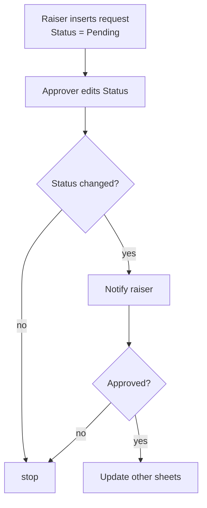

# Approval by status

## Task

Someone raises a request; an approver accepts or rejects it; the raiser is told; on approval, other records change.

## How

- Request sheet has a `pickText` status: `Pending | Approved | Rejected` (shared `setOfText` var).
- Approver = role with update on the sheet, plus a `pickUser` Manager field and a team view (`spreadsheetEditor` action @Manager).
- Workflow on `eventSsUpdateAfter`: `branchIfElse Curr.Status notEqualTo Prior.Status` → notify raiser (`sendPushNotification` / `sendMessageToUsers`) → if `Approved`, update other sheets (balance, attendance).
- Variant, two levels: one status field per level (`ManagerStatus`, `HRStatus`), one branch per field. Seen in NB-05.

## Workaround

Yes. Builds model approval as a status field + workflow branch, not as a separate approval step. Why: not known. Neome App catalog lists an Approval Workflows app (chains, multi-level, escalation); no sample Build uses it.

## Limits

- Not proven: who may change the status (per-field rights not in digests).
- No escalation or delegation seen.
- Each extra level = new status field + new branch.

## Flowchart

