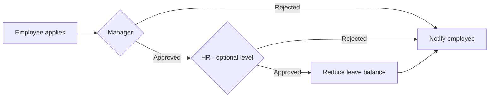

# Leave

## Usual needs

- Employee applies for leave: dates, full or half day, leave type, reason.
- Day count works out itself (minus holidays and Sundays in NB-05).
- Manager approves or rejects; NB-05 adds HR as second level.
- Employee is told of the decision.
- Leave balance per employee and type drops on approval.
- HR keeps leave types and policy (yearly entitlement, carry forward) — NB-02 only.
- Approved leave marks attendance — NB-04 only.
- Views: my leaves, my team's leaves, all leaves (HR/admin).

## Process steps

1. Apply → 2. Manager decides → 3. (HR decides) → 4. Balance updated → 5. Employee told (team told in NB-05).

## Usual sheets, key fields, roles

- Leave request: Employee `pickUser`, Manager `pickUser`, FromDate, ToDate, Duration `{Half Day|Full Day}`, LeaveType `ref`, NumberOfDays, Reason, Status `{Pending|Approved|Rejected}`.
- Leave type (master), Leave balance register (employee × type). Policy sheet NB-02 only.
- Roles: Employee, Manager, HR / Admin.

## Neome App / Delivery hint

`attendance-and-leave`, Configuration. Hint only, to confirm.

## Flowchart

