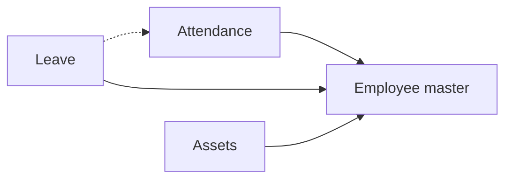

# Small company HR desk

## Modules

- Core: Employee master, Attendance, Leave.
- Optional: Payroll, Expenses, Grievance, Assets.

## Links between modules

- Leave → Employee master: leave type and employee rows (ref).
- Attendance → Employee master (ref).
- Assets → Employee master (ref).
- Leave → Attendance: approved leave marks attendance (NB-04, not NB-05).
- Payroll: no ref to other areas seen in NB-05 digest.

## Flowchart

