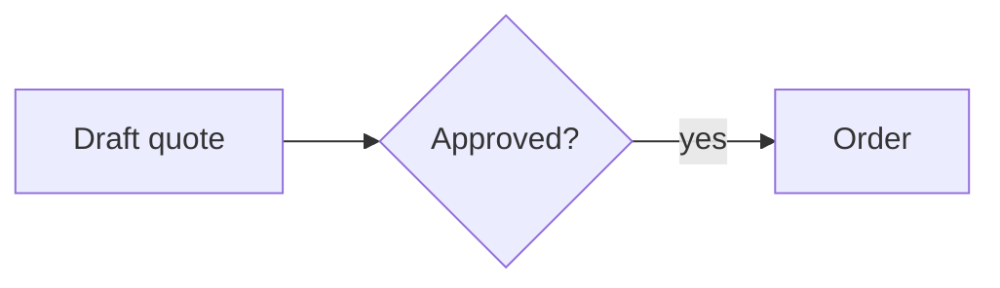

# Quotation & Order Flow

## Gives

- Rep drafts a quote for a customer.
- Manager approves a quote; approved quote turns into an order.

## Sheets, key fields, roles

- Quote: Customer, Items, Total, Status `{Draft|Approved|Rejected}`.
- Roles: Sales Rep, Manager.

## Workflows

- Quote approval: on submit → Manager approves or rejects → notify Rep.

## Flowchart

