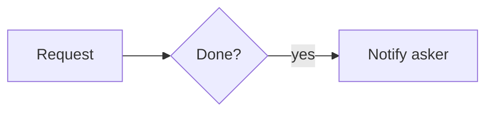

# Widget Desk

App baseline: what the Neome App gives out of the box.

## Gives

- Staff raise a widget request.
- Checker ticks a request done; asker is told.

## Sheets, key fields, roles

- Widget request: Asker `pickUser`, Flag `{Open|Done}`.
- Roles: Staff, Checker.

## Workflows

- Request done: on update, branch if Flag = Done → notify asker.

## Flowchart

