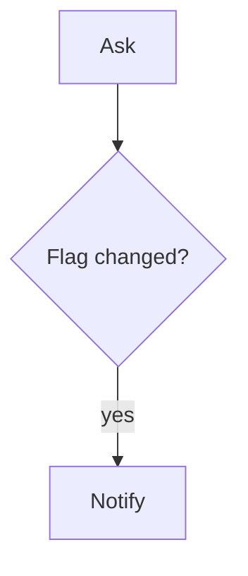

# Sign-off by flag

## Task

Someone asks for a widget; a checker ticks a flag; the asker is told.

## How

- Widget sheet has a `pickText` flag: `Open | Done`.
- Workflow on update: branch if flag changed → notify asker.

## Workaround

Yes. Flag + branch, not a sign-off step. Why: not known.

## Limits

- One level only.

## Flowchart

