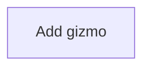

# Gizmos

## Usual needs

- Keep a list of gizmos.

## Process steps

1. Add gizmo.

## Usual sheets, key fields, roles

- Gizmo: Name, Owner `pickUser`.

## Neome App / Delivery hint

None, Custom module. Hint only, to confirm.

## Flowchart

