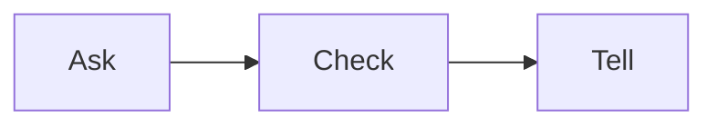

# Widgets

## Usual needs

- Staff ask for a widget.
- Checker ticks done.

## Process steps

1. Ask → 2. Check → 3. Tell.

## Usual sheets, key fields, roles

- Widget request: Asker `pickUser`, Flag `{Open|Done}`.
- Roles: Staff, Checker.

## Neome App / Delivery hint

`widget-desk`, Configuration. Hint only, to confirm.

## Flowchart

