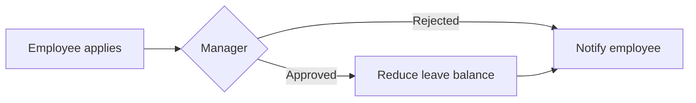

# Attendance & Leave

App baseline (fixture): what the Neome App gives out of the box for leave.

## Gives

- Employee applies for leave from the phone: from and to dates, leave type, reason.
- Line manager approves or rejects in one step.
- Employee is told of the decision.
- Leave balance per employee and leave type drops on approval.
- Leave type and holiday lists kept by HR.
- Views: my leaves, my team's leaves, all leaves (HR).

## Sheets, key fields, roles

- Leave request: Employee `pickUser`, Manager `pickUser`, FromDate, ToDate, LeaveType `ref`, NumberOfDays, Reason, Status `{Pending|Approved|Rejected}`.
- Leave type (master), Leave balance register (employee × type), Holiday list.
- Roles: Employee, Manager, HR.

## Workflows

- Leave approval: on submit → Manager approves or rejects → balance reduced on approval → employee notified.

## Flowchart

