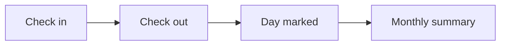

# Attendance

## Usual needs

- Employee checks in and out from the phone each day.
- Late arrival marked against a shift start time.
- Daily list of who is in, late, on leave or absent, for managers.
- Monthly attendance summary per employee.

## Process steps

1. Check in → 2. Check out → 3. Day marked (in / late / absent / on leave) → 4. Monthly summary.

## Usual sheets, key fields, roles

- Attendance record: Employee `pickUser`, Date, CheckIn, CheckOut, Status `{In|Late|Absent|On leave}`.
- Shift (master).
- Roles: Employee, Manager, HR.

## Neome App / Delivery hint

`attendance-and-leave`, Standard. Hint only, to confirm.

## Flowchart

