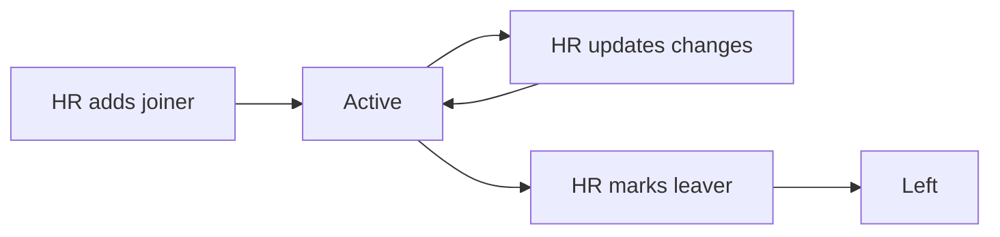

# Employee master

## Usual needs

- One list of staff: name, employee code, line manager, department, start date, phone, status.
- Leaving is a status change with a date; nobody is deleted.
- Other Modules pick the employee and the line manager from this list.

## Process steps

1. HR adds a joiner → 2. HR updates changes → 3. HR marks a leaver.

## Usual sheets, key fields, roles

- Employee: Name, EmployeeCode, User `pickUser`, LineManager `pickUser`, Department `ref`, StartDate, Status `{Active|Left}`.
- Department (master).
- Roles: HR, Manager, Employee.

## Neome App / Delivery hint

`employee-directory`, Standard. Hint only, to confirm.

## Flowchart

