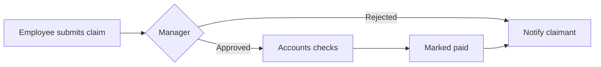

# Expenses

## Usual needs

- Employee submits a claim from the phone: date, category, amount, receipt photo.
- Spending limit per category, checked at submission; a claim over the limit needs an extra approval.
- Mileage claims at a fixed rate per km.
- Claim tagged to a project or client.
- Line manager approves or rejects; claimant is told.
- Accounts checks approved claims and marks them paid.
- Monthly spend by category report.

## Process steps

1. Submit → 2. Manager decides → 3. Accounts checks → 4. Paid → 5. Claimant told.

## Usual sheets, key fields, roles

- Expense claim: Employee `pickUser`, Manager `pickUser`, Date, Category `ref`, Amount, Receipt `image`, Project `ref`, Status `{Pending|Approved|Rejected|Paid}`.
- Category (master, with limit), Mileage rate.
- Roles: Employee, Manager, Accounts.

## Neome App / Delivery hint

`expense-management`, Standard. Hint only, to confirm.

## Flowchart

