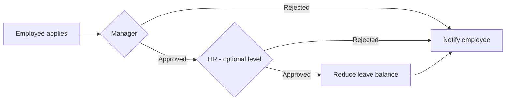

# Leave

## Usual needs

- Employee applies for leave from the phone: from and to dates, leave type, reason.
- Half-day leave as well as full days.
- Day count works out itself, leaving out weekends and public holidays.
- Line manager approves or rejects; NB-83 adds HR as a second level.
- Employee is told of the decision.
- The whole team is told when someone's leave is approved.
- Leave balance per employee and leave type drops on approval.
- Unused leave carries forward to next year, up to a cap.
- Views: my leaves, my team's leaves, all leaves (HR).

## Process steps

1. Apply → 2. Manager decides → 3. (HR decides) → 4. Balance updated → 5. Employee told.

## Usual sheets, key fields, roles

- Leave request: Employee `pickUser`, Manager `pickUser`, FromDate, ToDate, Duration `{Half Day|Full Day}`, LeaveType `ref`, NumberOfDays, Reason, Status `{Pending|Approved|Rejected}`.
- Leave type (master), Leave balance register (employee × type), Holiday list.
- Roles: Employee, Manager, HR.

## Neome App / Delivery hint

`attendance-and-leave`, Standard. No Build linked leave to payroll. Hint only, to confirm.

## Flowchart

