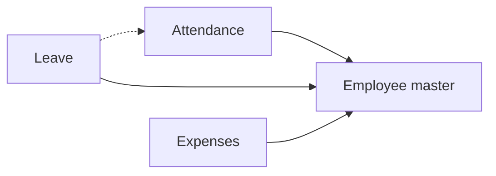

# Small company HR desk

## Modules

- Core: Employee master, Attendance, Leave.
- Optional: Expenses.

## Links between modules

- Leave → Employee master: employee and line manager (ref).
- Attendance → Employee master (ref).
- Expenses → Employee master: claimant and line manager (ref).
- Leave → Attendance: approved leave marks the day "on leave" (NB-81 only).

## Flowchart

