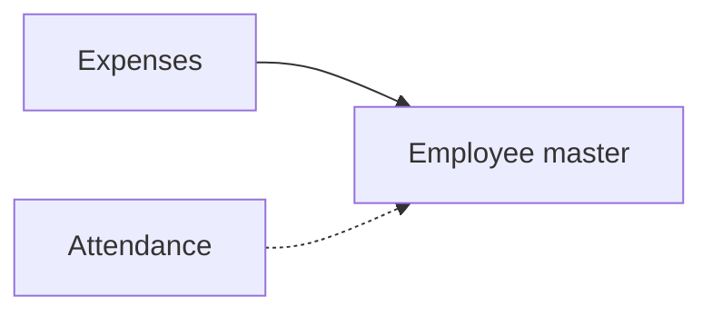

# Small sales office

## Modules

- Core: Employee master (sales reps and their managers), Expenses (claims from the road).
- Optional: Attendance (field check-in).
- The sales pipeline (leads, quotations, orders) runs on the `crm` Neome App; no Template module for it in this Template bank yet.

## Links between modules

- Expenses → Employee master: sales rep and manager (ref).
- Attendance → Employee master (ref).

## Flowchart

