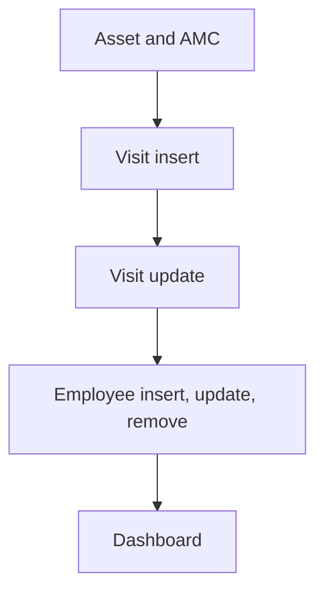

# AMC & Service Management

App baseline: what the Neome App gives out of the box, learnt from NA-amc-and-service-management.

## Gives

- Admin keeps asset categories, locations, assets, customers and staff.
- Admin records AMC contracts per asset with dates, SLA hours and price.
- Visits are planned for a technician with a reminder message.
- Completing a visit records resolution date and hours.
- Adding staff creates the app user; status change activates or deactivates it.
- Dashboard shows total and upcoming visits by date range.
- Master data screen opens each master list.

## Sheets, key fields, roles

- Asset: Category →AssetCategory, Location →Location, Customer →Customer, PurchaseDate, InstallationDate, FrequencyOfVisit {pickText}
- AMC: Asset →Asset, StartDate, EndDate, SLAHours, Price, Status {pickText}
- AMCVisit: AMC →AMC, PlannedVisitDate, Technician @ServiceTechnician, Status {pickText}, ResolutionHours
- Employee: Employee @ServiceTechnician, Roles, Status {pickText}
- Customer: CustomerName, MobileNumber, Email, Address
- Roles: OrganizationAdmin, ServiceManager, ServiceTechnician.

## Workflows

- Asset and AMC: admin adds asset, then AMC contract with dates, SLA hours and price.
- Visit insert: per-row scheduler starts; sub workflow sends reminder to the technician before the visit.
- Visit update: status turns completed; resolution date and hours are set on the row.
- Employee insert, update, remove: app user added, switched on or off by status, removed.
- Dashboard: total and upcoming visits merged for a date range.

## Flowchart

## Execute

Only use this to apply this into a Studio Enterprise via MCP.

Only if Neome App amc-and-service-management is not installed (check `list` first): rebuild what Gives lists. If installed, reuse it and build only gaps. Placeholders: AssetCategorySheet, LocationSheet, CustomerSheet, AssetSheet, AmcSheet, AmcVisitSheet, EmployeeSheet, VarAmcStatus, VarVisitStatus, VarEmployeeStatus. Needs first: none.

1. Roles + vars: `add kind=role` OrganizationAdmin, ServiceManager, ServiceTechnician; `add kind=var kind=setOfText deploy=fixedOnDeploy` VarAmcStatus, VarVisitStatus, VarEmployeeStatus.
2. Masters: AssetCategory: Name → sheet; Location: Name → sheet; Customer: CustomerName, MobileNumber `type=mobileNumber`, Email, Address → sheet. Each `add kind=form` → `kind=composite type=section` → fields → `add kind=spreadsheet` → `kind=spreadsheetLayout kind=table` + `kind=list`.
3. Asset: Category `type=ref spreadsheet=AssetCategorySheet`, Location `type=ref spreadsheet=LocationSheet`, Customer `type=ref spreadsheet=CustomerSheet` (each `layoutSpreadsheet=<list>`), PurchaseDate, InstallationDate `type=date`, FrequencyOfVisit `type=pickText` → sheet → table + list layouts. AMC: Asset `type=ref spreadsheet=AssetSheet layoutSpreadsheet=<list>`, StartDate, EndDate `type=date`, SLAHours `type=number`, Price `type=decimal`, Status `type=pickText source=VarAmcStatus` → sheet.
4. AMCVisit: Amc `type=ref spreadsheet=AmcSheet`, PlannedVisitDate `type=dateTime`, Technician `type=pickUser roleIdDataSource=[ServiceTechnician]`, Status `type=pickText source=VarVisitStatus`, ResolutionDate `type=date`, ResolutionHours `type=number`, SchedulerId `type=schedulerId` → sheet.
5. Employee: Name, Roles `type=setOfRole`, Status `type=pickText source=VarEmployeeStatus` → sheet. App user kept in step: apply PAT-sheet-row-drives-app-user Execute + PAT-soft-disable-by-status.
6. Reminder: apply PAT-per-row-scheduler + PAT-scheduled-reminder-message Execute (`executeScheduler` per visit → sub workflow → `sendMessageToUsers` to Technician).
7. Visit close: `add kind=workflow` (4 maps `{}`) → `add kind=node kind=eventSsUpdateAfter spreadsheet=AmcVisitSheet` → `kind=branchSwitchCase field={param:"$Curr",field:"Status"}` → VALUE `keyCompleted`: `rowUpdate` sets ResolutionDate, ResolutionHours; edges via `set kind=workflow edgeMap` (NEXT, VALUE). Same shape as PAT-act-on-status-change.
8. Dashboard: apply PAT-query-report-with-filter + PAT-composite-report Execute (total and upcoming visits by date range); Masters menu: PAT-action-set-menu.
9. Actions + group: `add kind=action kind=spreadsheetEditor` per sheet + `kind=rowInsert` for AMCVisit → `set kind=group actionPermissionMap` (OrganizationAdmin all; ServiceManager AMC + visits; ServiceTechnician visits).
10. `validate` till ok=true. `describe` sheets and workflows.

Gaps: AssetCategory and Location fields beyond Name unverified (verify: describe on NA); status option keys depend on the var keys (verify: describe); edgeMap entry keys unverified (wire 1 edge, describe, mirror).
