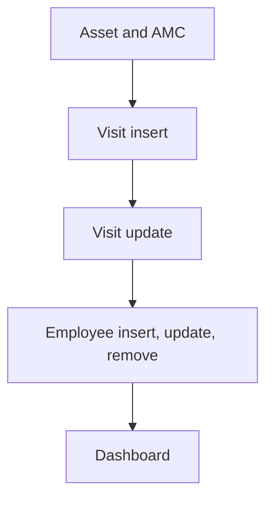

# AMC & Service Management

App baseline: what the Neome App gives out of the box, learnt from NA-amc-and-service-management.

## Gives

- Admin keeps asset categories, locations, assets, customers and staff.
- Admin records AMC contracts per asset with dates, SLA hours and price.
- Visits are planned for a technician with a reminder message.
- Completing a visit records resolution date and hours.
- Adding staff creates the app user; status change activates or deactivates it.
- Dashboard shows total and upcoming visits by date range.
- Master data screen opens each master list.

## Sheets, key fields, roles

- Asset: Category →AssetCategory, Location →Location, Customer →Customer, PurchaseDate, InstallationDate, FrequencyOfVisit {pickText}
- AMC: Asset →Asset, StartDate, EndDate, SLAHours, Price, Status {pickText}
- AMCVisit: AMC →AMC, PlannedVisitDate, Technician @ServiceTechnician, Status {pickText}, ResolutionHours
- Employee: Employee @ServiceTechnician, Roles, Status {pickText}
- Customer: CustomerName, MobileNumber, Email, Address
- Roles: OrganizationAdmin, ServiceManager, ServiceTechnician.

## Workflows

- Asset and AMC: admin adds asset, then AMC contract with dates, SLA hours and price.
- Visit insert: per-row scheduler starts; sub workflow sends reminder to the technician before the visit.
- Visit update: status turns completed; resolution date and hours are set on the row.
- Employee insert, update, remove: app user added, switched on or off by status, removed.
- Dashboard: total and upcoming visits merged for a date range.

## Flowchart

