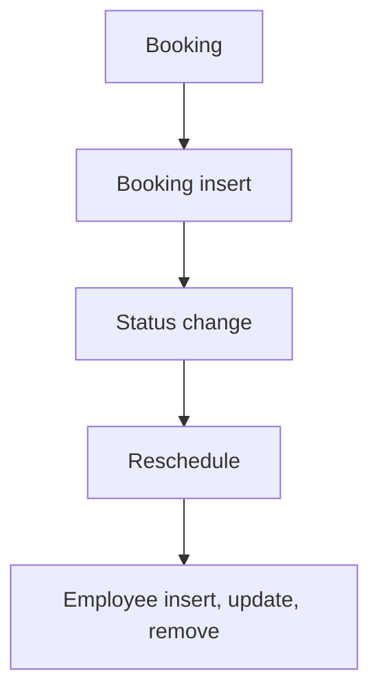

# Appointment Booking

App baseline: what the Neome App gives out of the box, learnt from NA-appointment-booking.

## Gives

- Admin keeps service types, weekly availability times and staff.
- Staff row creates, updates, deactivates or removes the app user.
- Customer books an appointment for a service, date and free time.
- Booking, reminder, cancel, no-show, reschedule and done messages go on WhatsApp.
- Reminder is scheduled per appointment and moves when the date changes.
- Customer gets a link to reschedule or cancel; OTP check is on the form.
- Reschedule of a completed or cancelled appointment is blocked.
- Master data screen and a dashboard of totals, per service, weekly and no-show counts.

## Sheets, key fields, roles

- ServiceType: ServiceType*, MaxDuration*, Color, IsActive {pickText}
- Availability: Day {pickText}, IsAvailable {pickText}, time grid FromTime/ToTime, Error
- Employee: EmployeeName*, Employee pickUser, Roles, Manager pickUser, Status {pickText}
- Appointment: RefServiceType →ServiceType, AppointmentDate*, free-time ref report, FromTime/ToTime ⇐report, Name*, MobileNumber*, Status {pickText}, RescheduleLink, SchedulerId
- RescheduleAppointment: RefAppointment →Appointment, Action {pickText}, NewDate, free-time ref report, OTP verification
- Roles: OrganizationAdmin.

## Workflows

- Booking: appointment made for a service, date and free time from a free-time report; ID made.
- Booking insert: booking message on WhatsApp; per-row scheduler set for the reminder.
- Status change: switch on status sends cancel, no-show or done message.
- Reschedule: customer opens deep link, gets OTP by button, picks new date or cancels; completed or cancelled appointments are blocked; appointment row updated and scheduler moved.
- Employee insert, update, remove: app user kept in step with the row.

## Flowchart

