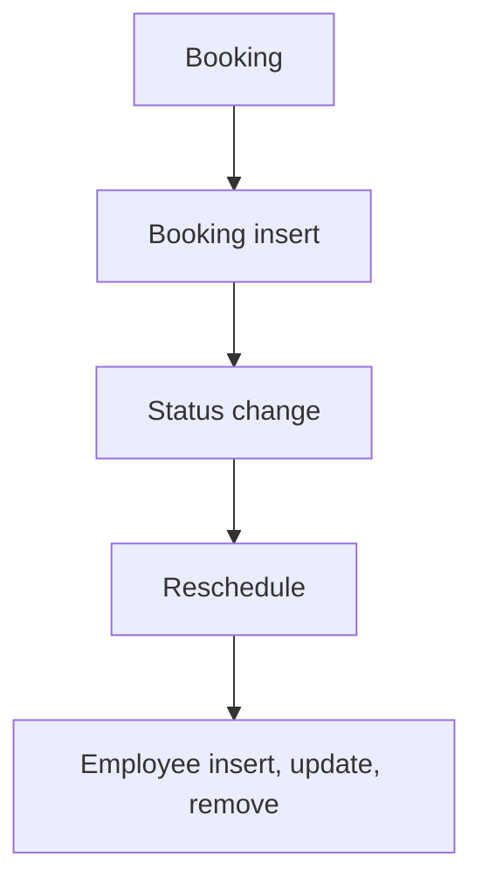

# Appointment Booking

App baseline: what the Neome App gives out of the box, learnt from NA-appointment-booking.

## Gives

- Admin keeps service types, weekly availability times and staff.
- Staff row creates, updates, deactivates or removes the app user.
- Customer books an appointment for a service, date and free time.
- Booking, reminder, cancel, no-show, reschedule and done messages go on WhatsApp.
- Reminder is scheduled per appointment and moves when the date changes.
- Customer gets a link to reschedule or cancel; OTP check is on the form.
- Reschedule of a completed or cancelled appointment is blocked.
- Master data screen and a dashboard of totals, per service, weekly and no-show counts.

## Sheets, key fields, roles

- ServiceType: ServiceType*, MaxDuration*, Color, IsActive {pickText}
- Availability: Day {pickText}, IsAvailable {pickText}, time grid FromTime/ToTime, Error
- Employee: EmployeeName*, Employee pickUser, Roles, Manager pickUser, Status {pickText}
- Appointment: RefServiceType →ServiceType, AppointmentDate*, free-time ref report, FromTime/ToTime ⇐report, Name*, MobileNumber*, Status {pickText}, RescheduleLink, SchedulerId
- RescheduleAppointment: RefAppointment →Appointment, Action {pickText}, NewDate, free-time ref report, OTP verification
- Roles: OrganizationAdmin.

## Workflows

- Booking: appointment made for a service, date and free time from a free-time report; ID made.
- Booking insert: booking message on WhatsApp; per-row scheduler set for the reminder.
- Status change: switch on status sends cancel, no-show or done message.
- Reschedule: customer opens deep link, gets OTP by button, picks new date or cancels; completed or cancelled appointments are blocked; appointment row updated and scheduler moved.
- Employee insert, update, remove: app user kept in step with the row.

## Flowchart

## Execute

Only use this to apply this into a Studio Enterprise via MCP.

Only if Neome App appointment-booking is not installed (check `list` first): rebuild what Gives lists. If installed, reuse it and build only gaps. Placeholders: ServiceTypeSheet, AvailabilitySheet, AppointmentSheet, RescheduleSheet, VarDay, VarAppointmentStatus, VarRescheduleAction. Needs first: none.

1. Roles + vars: `add kind=role` OrganizationAdmin; `add kind=var kind=setOfText deploy=fixedOnDeploy` VarDay, VarAppointmentStatus, VarRescheduleAction; `add kind=var kind=duration` reminder lead time.
2. ServiceType: `add kind=form` → `kind=composite type=section` → ServiceType `type=text`, MaxDuration `type=duration`, Color `type=color`, IsActive `type=bool` → `add kind=spreadsheet` → `kind=spreadsheetLayout kind=table` + `kind=list`.
3. Availability: Day `type=pickText source=VarDay`, IsAvailable `type=bool`, Error `type=error`, plus `kind=composite type=grid` Slots with FromTime, ToTime `type=time` → sheet. No overlaps: apply PAT-error-field-check Execute.
4. Free-time report first: apply PAT-query-report-with-filter Execute (open slots for a date + service).
5. Appointment: RefServiceType `type=ref spreadsheet=ServiceTypeSheet layoutSpreadsheet=<list>`, AppointmentDate `type=date`, Slot `type=pickReportRow report=<FreeTimeReport>`, Name `type=text`, MobileNumber `type=mobileNumber`, Status `type=pickText source=VarAppointmentStatus`, RescheduleLink `type=hyperlink`, SchedulerId `type=schedulerId` → sheet. Id: PAT-generated-id; FromTime / ToTime copied from slot: PAT-copy-fields-from-ref.
6. Booking insert: `add kind=workflow` (4 maps `{}`) → `add kind=node kind=eventSsInsertAfter spreadsheet=AppointmentSheet` → `sendMessageToUsers` (WhatsApp booking message) → `executeScheduler` sets the reminder; edges via `set kind=workflow edgeMap` NEXT chain.
7. Status change: `kind=eventSsUpdateAfter spreadsheet=AppointmentSheet` → `kind=branchSwitchCase field={param:"$Curr",field:"Status"}` → VALUE edges send the cancel / no-show / done message (PAT-act-on-status-change).
8. Reschedule: RescheduleAppointment form (RefAppointment `type=ref spreadsheet=AppointmentSheet`, Action `type=pickText source=VarRescheduleAction`, NewDate `type=date`, OTP `type=text`) → sheet; customer link: apply PAT-deeplink-to-form Execute (`add kind=deeplink kind=spreadsheetInsert visibilityConstraint=allowPublicSharing expiry=noExpiry`); OTP by button: PAT-button-runs-workflow + PAT-stop-save-by-workflow-check; completed / cancelled blocked; scheduler moves with the date: PAT-update-linked-rows.
9. Staff users: PAT-sheet-row-drives-app-user + PAT-soft-disable-by-status. Dashboard: PAT-composite-report (totals, per service, weekly, no-show). Masters menu: PAT-action-set-menu.
10. Actions + group: `kind=spreadsheetEditor` per sheet + `kind=rowInsert` for Appointment → `set kind=group actionPermissionMap` (OrganizationAdmin).
11. `validate` till ok=true. `describe` sheets, deeplink and workflows.

Gaps: pickReportRow needs the report output grid + layout (verify: describe); OTP send and check shape not in the guide; edgeMap entry keys unverified (wire 1 edge, describe, mirror).
