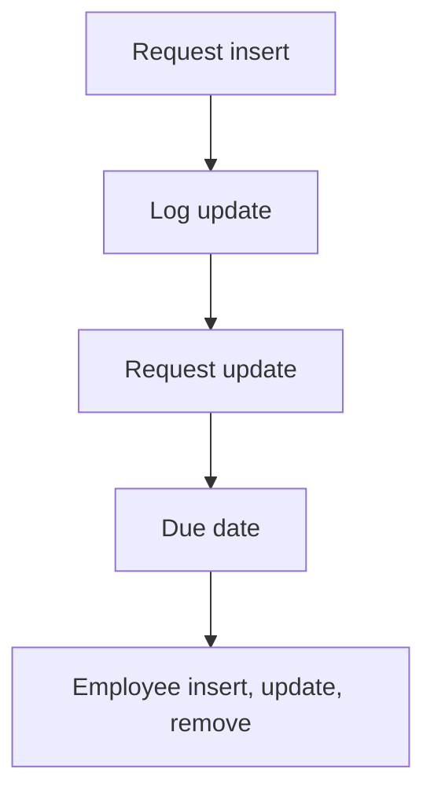

# Approval Workflows

App baseline: what the Neome App gives out of the box, learnt from NA-approval-workflows.

## Gives

- Admin keeps departments and an approval matrix of levels with approvers.
- Requestor raises an approval request with department, due date and attachments.
- Request goes to approvers by level; each approver updates a log row.
- Last approver's approval sets request approved; a rejection sets it rejected.
- Requestor gets a message on status change and on due date.
- Pending approval report and dashboard by date range.
- Employee sheet adds, updates and removes app users.

## Sheets, key fields, roles

- Department: Department
- ApprovalMatrix: Department →Department, LevelSequence, Approver @Approver
- ApprovalRequest: ApprovalId, Department →Department, Title, Status {pickText}, DueDate, RemainderDateTime, Approvers, Attachments
- ApprovalLog: ApprovalId, Level, Approver @Approver, Status {pickText}, LastApprover, Disable
- Employee: EmployeeName, Handle, Roles, Manager, Status {pickText}
- Roles: Approver, Requestor, OrganizationAdmin.

## Workflows

- Request insert: ID set; matrix rows for the department are read; one log row added per level; request forwarded to approvers.
- Log update: approver sets approved or rejected; a rejection sets the request rejected; last approver's approval sets it approved.
- Request update: status change messages the requestor.
- Due date: scheduler sub workflow reminds the requestor.
- Employee insert, update, remove: app user kept in step with the row.

## Flowchart

