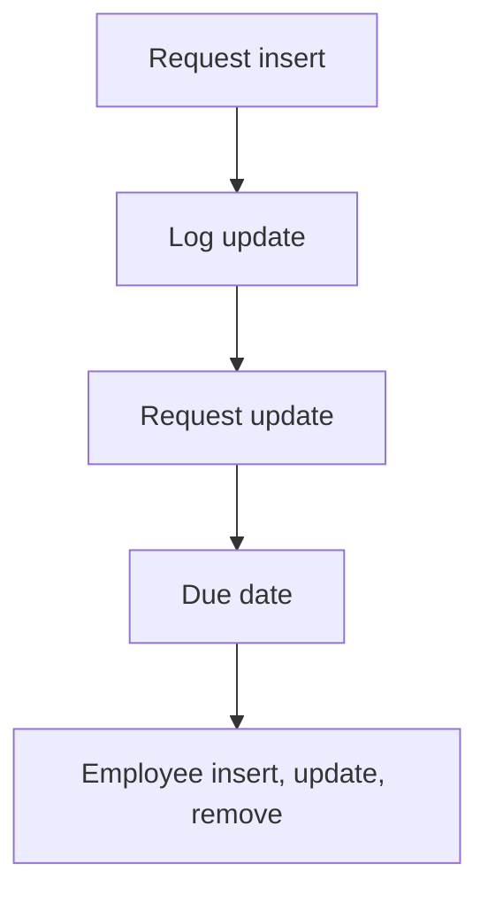

# Approval Workflows

App baseline: what the Neome App gives out of the box, learnt from NA-approval-workflows.

## Gives

- Admin keeps departments and an approval matrix of levels with approvers.
- Requestor raises an approval request with department, due date and attachments.
- Request goes to approvers by level; each approver updates a log row.
- Last approver's approval sets request approved; a rejection sets it rejected.
- Requestor gets a message on status change and on due date.
- Pending approval report and dashboard by date range.
- Employee sheet adds, updates and removes app users.

## Sheets, key fields, roles

- Department: Department
- ApprovalMatrix: Department →Department, LevelSequence, Approver @Approver
- ApprovalRequest: ApprovalId, Department →Department, Title, Status {pickText}, DueDate, RemainderDateTime, Approvers, Attachments
- ApprovalLog: ApprovalId, Level, Approver @Approver, Status {pickText}, LastApprover, Disable
- Employee: EmployeeName, Handle, Roles, Manager, Status {pickText}
- Roles: Approver, Requestor, OrganizationAdmin.

## Workflows

- Request insert: ID set; matrix rows for the department are read; one log row added per level; request forwarded to approvers.
- Log update: approver sets approved or rejected; a rejection sets the request rejected; last approver's approval sets it approved.
- Request update: status change messages the requestor.
- Due date: scheduler sub workflow reminds the requestor.
- Employee insert, update, remove: app user kept in step with the row.

## Flowchart

## Execute

Only use this to apply this into a Studio Enterprise via MCP.

Only if Neome App approval-workflows is not installed (check `list` first): rebuild what Gives lists. If installed, reuse it and build only gaps. Placeholders: DepartmentSheet, ApprovalMatrixSheet, ApprovalRequestSheet, ApprovalLogSheet, EmployeeSheet, VarApprovalStatus. Needs first: none.

1. Roles + vars: `add kind=role` Requestor, Approver, OrganizationAdmin; `add kind=var kind=setOfText deploy=fixedOnDeploy` VarApprovalStatus; `add kind=var kind=sequence` ApprovalIdStart.
2. Department: `add kind=form` → `kind=composite type=section` → Department `type=text` → `add kind=spreadsheet` → `kind=spreadsheetLayout kind=table` + `kind=list`.
3. ApprovalMatrix: Department `type=ref spreadsheet=DepartmentSheet layoutSpreadsheet=<list>`, LevelSequence `type=number`, Approver `type=pickUser roleIdDataSource=[Approver]` → sheet (`queryables=["Department"]`).
4. ApprovalRequest: ApprovalId `type=identifier`, Department `type=ref`, Title `type=text`, Status `type=pickText source=VarApprovalStatus`, DueDate `type=date`, RemainderDateTime `type=dateTime`, Approvers `type=setOfUser`, Attachments `type=setOfDocument` → sheet. Id: PAT-generated-id.
5. ApprovalLog: ApprovalId, Level `type=number`, Approver `type=pickUser`, Status `type=pickText`, LastApprover `type=bool`, Disable `type=bool` → sheet (`updateRoles=["Approver"]`); Disable locks the row: PAT-lock-fields-by-visibility.
6. Request insert: `add kind=workflow` (4 maps `{}`) → `add kind=node kind=eventSsInsertAfter spreadsheet=ApprovalRequestSheet` → `kind=branchIterateSpreadsheet spreadsheet=ApprovalMatrixSheet filterCondition=<request department>` → ITERATE `rowInsert spreadsheet=ApprovalLogSheet` (one per level) → NEXT `rowForward` to approvers; edges via `set kind=workflow edgeMap` (NEXT, ITERATE).
7. Log update: `kind=eventSsUpdateAfter spreadsheet=ApprovalLogSheet` → `kind=branchIfElse option=Condition`: rejected → `rowUpdate` request Status keyRejected; else last level approved → keyApproved. Apply PAT-multi-level-approval + PAT-approval-by-status Execute.
8. Request update + due date: `eventSsUpdateAfter` Status → `sendMessageToUsers` to the requestor (PAT-message-on-event); reminder sub workflow on `kind=eventSchedule scheduler={repeatSetting:...}` (PAT-scheduled-reminder-message).
9. Employee sheet: Name, Handle `type=mobileNumber`, Roles `type=setOfRole`, Manager `type=pickUser`, Status `type=pickText` → sheet; users kept in step: PAT-sheet-row-drives-app-user + PAT-soft-disable-by-status.
10. Reports: PAT-query-report-with-filter (pending approvals) + PAT-composite-report (dashboard by date range).
11. Actions + group: `kind=rowInsert` ApprovalRequest + `kind=spreadsheetEditor` per sheet → `set kind=group actionPermissionMap` (Requestor insert; Approver logs; OrganizationAdmin all).
12. `validate` till ok=true. `describe` sheets and workflows.

Gaps: iterate `filterCondition` on the request's Department (verify: describe); edgeMap entry keys unverified (wire 1 edge, describe, mirror).
