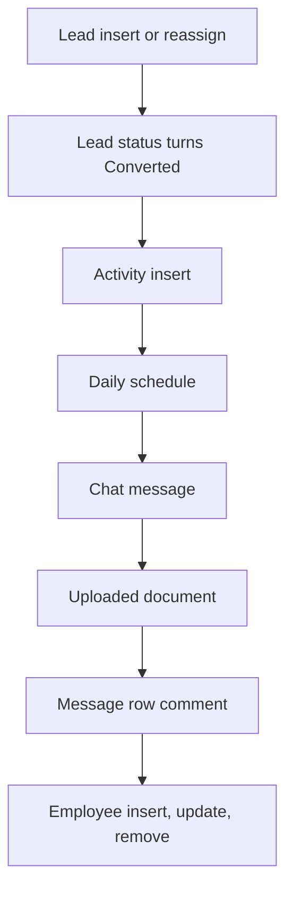

# CRM

App baseline: what the Neome App gives out of the box, learnt from NA-crm.

## Gives

- Leads with source, status, assignee and activity count; assigned user gets a message.
- Converting a lead creates Account, Contact person and Opportunity.
- Opportunity pipeline with stages, expected value and lost reason.
- Activity log per lead or opportunity, with follow-up reminders and optional task.
- Task list per sales executive.
- Account and contact person masters with admin-kept lists (type, industry, city, payment terms, stage, activity type).
- Lead, sales performance and lead report dashboards.
- Daily reminders for follow-ups and ageing leads.
- Chat message or uploaded document is read by AI into a new lead.
- Employee sheet creates, updates and removes app users.
- Owner opens one Master menu to reach the master lists.

## Sheets, key fields, roles

- Lead: Source, Status {New|Contacted|On Hold|Qualified|Disqualified|Converted}, AssignedTo →Employee, TotalActivitiesPerformed logNumber
- Activity: Source refTarget, ActivityType →ActivityType, FollowUpDateTime, TaskRequiredYesNo
- Opportunity: Account →Account, Stage {Qualified|Requirement Study|Demo / Presentation|Proposal / Quotation|Negotiation|Closed Won|Closed Lost}, ExpectedValue, LostReason →LostReason
- Contact: contact person, Account →Account
- Account: AccountType →AccountType, IndustryType →IndustryType, City →City, Employee →Employee
- Task: Title, AssignedTo →Employee, Status
- Employee: Handle, Roles, Manager, Status
- Roles: SalesExecutive, SalesManager, Owner.

## Workflows

- Lead insert or reassign: assignee is messaged.
- Lead status turns Converted: account, contact person and opportunity rows are added.
- Activity insert: lead activity count goes up; follow-up reminders 30 and 15 minutes before; task added when asked.
- Daily schedule: follow-up and ageing lead reminders.
- Chat message: AI classifies it; makes a lead or sends a dashboard back as PDF or image.
- Uploaded document: AI reads it into a new lead.
- Message row comment: reply goes to the customer on WhatsApp.
- Employee insert, update, remove: app user kept in step with the row.

## Flowchart

## Execute

Only use this to apply this into a Studio Enterprise via MCP.

Only if Neome App crm is not installed (check `list` first): rebuild what Gives lists. If installed, reuse it and build only gaps. Placeholders: LeadSheet, ActivitySheet, OpportunitySheet, AccountSheet, ContactSheet, TaskSheet, EmployeeSheet, VarLeadStatus, VarOpportunityStage, VarActivityType. Needs first: none.

1. Roles + vars: `add kind=role` SalesExecutive, SalesManager, Owner; `add kind=var kind=setOfText deploy=fixedOnDeploy` VarLeadStatus (New, Contacted, On Hold, Qualified, Disqualified, Converted), VarOpportunityStage, VarActivityType; admin-kept lists (AccountType, IndustryType, City, PaymentTerms, LostReason): apply PAT-admin-kept-pick-list Execute.
2. Employee: Name, Handle `type=mobileNumber`, Roles `type=setOfRole`, Manager `type=pickUser`, Status `type=pickText` → sheet; users kept in step: PAT-sheet-row-drives-app-user + PAT-soft-disable-by-status.
3. Lead: Source `type=pickText`, Status `type=pickText source=VarLeadStatus`, AssignedTo `type=pickUser roleIdDataSource=[SalesExecutive]`, TotalActivitiesPerformed `type=logNumber` → sheet.
4. Activity: Source `type=refTarget` (lead or opportunity; `refTargetSpreadsheetMap` shape verify: describe), ActivityType `type=pickText source=VarActivityType`, FollowUpDateTime `type=dateTime`, TaskRequiredYesNo `type=bool` → sheet.
5. Account, Contact, Opportunity, Task: sections → sheets; Opportunity Stage `type=pickText source=VarOpportunityStage`, ExpectedValue `type=decimal`, LostReason `type=ref`; Account and Task ref Employee.
6. Lead insert / reassign: `add kind=workflow` (4 maps `{}`) → `add kind=node kind=eventSsInsertAfter spreadsheet=LeadSheet` (+ `kind=eventSsUpdateAfter` on AssignedTo) → `sendMessageToUsers` to the assignee; edges via `set kind=workflow edgeMap` NEXT.
7. Converted: `kind=eventSsUpdateAfter spreadsheet=LeadSheet` → `kind=branchSwitchCase field={param:"$Curr",field:"Status"}` → VALUE `keyConverted`: `rowInsert` Account, Contact, Opportunity (insert-row pattern in the guide).
8. Activity insert: `kind=eventSsInsertAfter spreadsheet=ActivitySheet` → `rowUpdateFieldLogNumber outputLogNumberField=TotalActivitiesPerformed operation=add` on the lead + follow-up reminders 30 / 15 minutes before (PAT-per-row-scheduler) + optional `rowInsert` Task (PAT-insert-row-in-other-sheet).
9. Daily schedule: `kind=eventSchedule scheduler={repeatSetting:{frequency:1,repeatFrequencyKind:"days"}}` → `kind=branchIterateSpreadsheet` over due follow-ups and ageing leads → `sendMessageToUsers`.
10. Chat + document: apply PAT-ai-reads-into-form Execute (`aiTextToForm` / `aiDocumentToForm` → `rowInsert spreadsheet=LeadSheet`); chat classes: PAT-chat-bot-by-message-class.
11. Row comment reply on WhatsApp: PAT-forward-row. Dashboards (leads, sales performance, lead report): PAT-composite-report. Masters menu: PAT-action-set-menu.
12. Actions + group: `kind=rowInsert` Lead + `kind=spreadsheetEditor` per sheet → `set kind=group actionPermissionMap` (Owner, SalesManager all; SalesExecutive own rows).
13. `validate` till ok=true. `describe` sheets and workflows.

Gaps: `refTargetSpreadsheetMap` shape (verify: describe); edgeMap entry keys unverified (wire 1 edge, describe, mirror).
