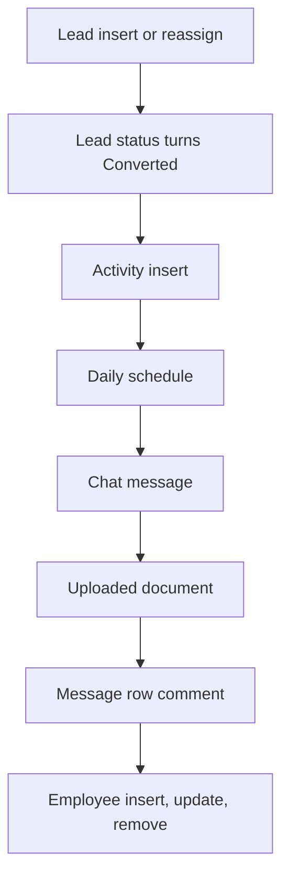

# CRM

App baseline: what the Neome App gives out of the box, learnt from NA-crm.

## Gives

- Leads with source, status, assignee and activity count; assigned user gets a message.
- Converting a lead creates Account, Contact person and Opportunity.
- Opportunity pipeline with stages, expected value and lost reason.
- Activity log per lead or opportunity, with follow-up reminders and optional task.
- Task list per sales executive.
- Account and contact person masters with admin-kept lists (type, industry, city, payment terms, stage, activity type).
- Lead, sales performance and lead report dashboards.
- Daily reminders for follow-ups and ageing leads.
- Chat message or uploaded document is read by AI into a new lead.
- Employee sheet creates, updates and removes app users.
- Owner opens one Master menu to reach the master lists.

## Sheets, key fields, roles

- Lead: Source, Status {New|Contacted|On Hold|Qualified|Disqualified|Converted}, AssignedTo →Employee, TotalActivitiesPerformed logNumber
- Activity: Source refTarget, ActivityType →ActivityType, FollowUpDateTime, TaskRequiredYesNo
- Opportunity: Account →Account, Stage {Qualified|Requirement Study|Demo / Presentation|Proposal / Quotation|Negotiation|Closed Won|Closed Lost}, ExpectedValue, LostReason →LostReason
- Account: AccountType →AccountType, IndustryType →IndustryType, City →City, Employee →Employee
- Task: Title, AssignedTo →Employee, Status
- Employee: Handle, Roles, Manager, Status
- Roles: SalesExecutive, SalesManager, Owner.

## Workflows

- Lead insert or reassign: assignee is messaged.
- Lead status turns Converted: account, contact person and opportunity rows are added.
- Activity insert: lead activity count goes up; follow-up reminders 30 and 15 minutes before; task added when asked.
- Daily schedule: follow-up and ageing lead reminders.
- Chat message: AI classifies it; makes a lead or sends a dashboard back as PDF or image.
- Uploaded document: AI reads it into a new lead.
- Message row comment: reply goes to the customer on WhatsApp.
- Employee insert, update, remove: app user kept in step with the row.

## Flowchart

