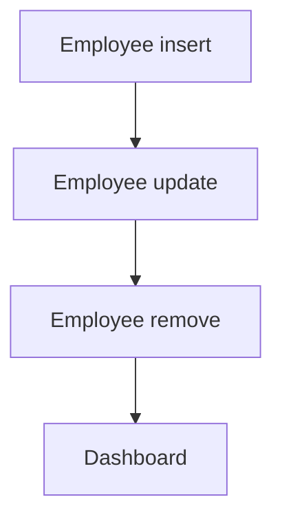

# Employee Directory

App baseline: what the Neome App gives out of the box, learnt from NA-employee-directory.

## Gives

- HR or admin adds and edits employees with personal, job, education and document details.
- App user is added, updated and removed with the employee row.
- Activate or deactivate user when Status changes.
- HR keeps department and designation lists.
- HR keeps joining and exit checklists.
- Dashboard shows total employees, departments, department count and new joiners.
- Master data report lists employees.

## Sheets, key fields, roles

- Employee: EmployeeName*, Employee @Employee, Manager @Manager, Department →Department, Designation →Designation, Roles setOfRole*, DateOfJoining*, MonthlyCompensation*, Status {pickText}*, ResignationDate
- Department: Department*
- Designation: Designation*
- JoiningChecklist: Title*, Description*
- ExitChecklist: Title*, Description*
- Roles: Employee, HR, Manager, OrganizationAdmin.

## Workflows

- Employee insert: app user added.
- Employee update: roles or manager change updates the user; status switches it on or off.
- Employee remove: app user removed.
- Dashboard: totals, departments, department count and new joiners.

## Flowchart

