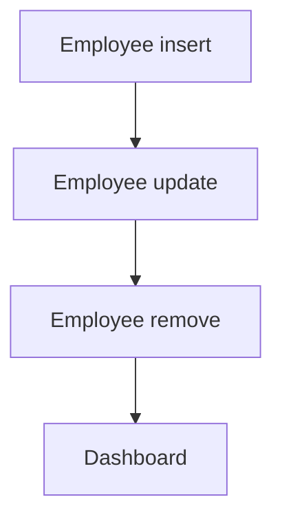

# Employee Directory

App baseline: what the Neome App gives out of the box, learnt from NA-employee-directory.

## Gives

- HR or admin adds and edits employees with personal, job, education and document details.
- App user is added, updated and removed with the employee row.
- Activate or deactivate user when Status changes.
- HR keeps department and designation lists.
- HR keeps joining and exit checklists.
- Dashboard shows total employees, departments, department count and new joiners.
- Master data report lists employees.

## Sheets, key fields, roles

- Employee: EmployeeName*, Employee @Employee, Manager @Manager, Department →Department, Designation →Designation, Roles setOfRole*, DateOfJoining*, MonthlyCompensation*, Status {pickText}*, ResignationDate
- Department: Department*
- Designation: Designation*
- JoiningChecklist: Title*, Description*
- ExitChecklist: Title*, Description*
- Roles: Employee, HR, Manager, OrganizationAdmin.

## Workflows

- Employee insert: app user added.
- Employee update: roles or manager change updates the user; status switches it on or off.
- Employee remove: app user removed.
- Dashboard: totals, departments, department count and new joiners.

## Flowchart

## Execute

Only use this to apply this into a Studio Enterprise via MCP.

Only if Neome App employee-directory is not installed (check `list` first): rebuild what Gives lists. If installed, reuse it and build only gaps.

Placeholders: EmployeeForm, EmployeeSheet, VarEmpStatus. Needs first: none.

1. Roles: `add kind=role name=Employee|HR|Manager|OrganizationAdmin details={}` (skip names that exist).
2. Vars: `add kind=var kind=setOfText name=VarEmpStatus deploy=fixedOnDeploy value={"Active":{},"Inactive":{}}`.
3. Pick sheets (`apply PAT-admin-kept-pick-list Execute`): DepartmentForm → DepartmentSheet, DesignationForm → DesignationSheet; each `add kind=spreadsheetLayout kind=table showComps` + `kind=list` for refs.
4. EmployeeForm: `add kind=form` → `add kind=composite type=section` → fields: `type=text EmployeeName required`, `type=pickUser Employee`, `type=pickUser Manager`, `type=ref spreadsheet=DepartmentSheet layoutSpreadsheet=DepartmentList`, same for Designation, `type=setOfRole Roles`, `type=date DateOfJoining`, `type=currency MonthlyCompensation`, `type=pickText Status source=VarEmpStatus`, `type=date ResignationDate`; education as a `type=grid` composite, documents as `type=setOfDocument`. `add kind=spreadsheet name=EmployeeSheet form=EmployeeForm` + `spreadsheetLayout kind=table showComps`.
5. Checklists: JoiningChecklist and ExitChecklist forms → sheets (`type=text Title required`, `type=paragraph Description`).
6. User sync: `apply PAT-sheet-row-drives-app-user Execute` — insert → `userAdd`, roles / manager change → `userUpdate`, Status → `userUpdate userActivateField`, remove → `userRemove`.
7. Dashboard + master data report: `apply PAT-composite-report Execute`; `add kind=action kind=report report=… outputFormContentLayout=…`; `set kind=group actionPermissionMap` (HR + OrganizationAdmin on every entry).
8. `validate` till ok=true.

Gaps: dashboard formulas per Enterprise (verify: describe on a built report).
