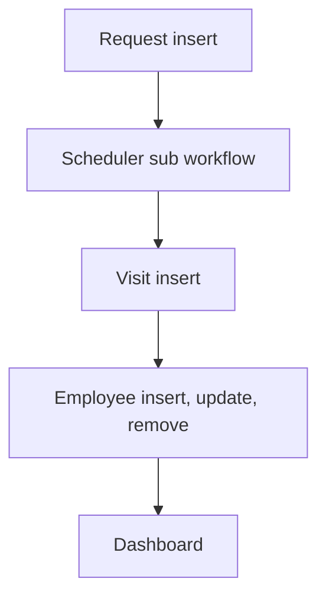

# Field Service

App baseline: what the Neome App gives out of the box, learnt from NA-field-service.

## Gives

- Admin keeps lists of service types (with SLA hours), territories, priorities and customers.
- Admin keeps employees; adding one creates an app user, role or status change updates it, removal deletes it.
- Manager or admin raises a service request for a customer, with type, territory, priority and assignee.
- Escalation time is worked out from request time and SLA hours.
- Manager and assignee get a message while the request is open.
- Technician logs a visit on a request with place, photo, resolution note and customer signature.
- Saving a visit updates the linked request.
- Resolution hours are worked out on request and visit.
- Monthly dashboard shows total requests, total visits and SLA breaches.

## Sheets, key fields, roles

- ServiceType: ServiceType, SLAHours
- Territory: Territory, Manager @ServiceManager
- Customer: CustomerName, MobileNumber, Email, Address
- Employee: EmployeeName, Employee user, Roles, RefTerritory →Territory, Status {pickText}
- ServiceRequest: RefCustomer →Customer, RefServiceType →ServiceType, RefTerritory →Territory, RefServicePriority →ServicePriority, AssignedTo, Status {pickText}, EscalateDateTime, ResolutionHours
- ServiceVisit: RefServiceRequest →ServiceRequest, Location, ResolutionDateTime, ResolutionImage, CustomerSignature, ResolutionHours
- Roles: ServiceTechnician, ServiceManager, OrganizationAdmin.

## Workflows

- Request insert: escalation time from SLA hours; per-row scheduler starts.
- Scheduler sub workflow: while request is open, manager and assignee are messaged.
- Visit insert: linked request row is updated; resolution hours worked out.
- Employee insert, update, remove: app user kept in step with the row.
- Dashboard: monthly requests, visits and SLA breaches.

## Flowchart

## Execute

Only use this to apply this into a Studio Enterprise via MCP.

Only if Neome App field-service is not installed (check `list` first): rebuild what Gives lists. If installed, reuse it and build only gaps.

Placeholders: ServiceRequestSheet, ServiceVisitSheet, VarRequestStatus. Needs first: none.

1. Roles: `add kind=role name=ServiceTechnician|ServiceManager|OrganizationAdmin details={}`.
2. Master sheets (`apply PAT-admin-kept-pick-list Execute`): ServiceType (+ `type=number SLAHours`), Territory (+ `type=pickUser Manager`), Customer (`type=mobileNumber`, `type=email`, Address), ServicePriority; each form → sheet → `spreadsheetLayout kind=table showComps` + `kind=list` for refs.
3. Employee: `apply PAT-sheet-row-drives-app-user Execute` (roles, `type=ref Territory`, Status).
4. ServiceRequestForm → ServiceRequestSheet: `type=ref` Customer / ServiceType / Territory / ServicePriority, `type=pickUser AssignedTo`, `type=pickText Status source=VarRequestStatus`, `type=dateTime EscalateDateTime`; `set kind=spreadsheet ref=ServiceRequestSheet queryables` add Status.
5. Escalation time: `add kind=formFormula assignToField=EscalateDateTime formula={value:"…SLAHours…"}` (`apply PAT-calculated-field Execute`).
6. ServiceVisitForm → ServiceVisitSheet: `type=ref ServiceRequest`, `type=location captureMode=onInsert`, `type=dateTime ResolutionDateTime`, `type=camera ResolutionImage`, `type=signature CustomerSignature`.
7. Reminders while open: `apply PAT-per-row-scheduler Execute` → `branchIfElse` Status Open → `sendMessageToUsers` to Manager + AssignedTo (`apply PAT-message-on-event Execute`).
8. Visit insert: `apply PAT-update-linked-rows Execute` — `kind=eventSsInsertAfter spreadsheet=ServiceVisitSheet` → `rowUpdate rowIdPointer={spreadsheet:ServiceRequestSheet,row:<from ref>}` sets status; resolution hours via formFormula.
9. Dashboard: `apply PAT-composite-report Execute` (monthly requests, visits, SLA breaches) + `add kind=action kind=report` + `set kind=group actionPermissionMap`.
10. `validate` till ok=true.

Gaps: per-row scheduler `scheduleTrigger` binder (verify: describe); SLA-hours formula JS per Enterprise.
