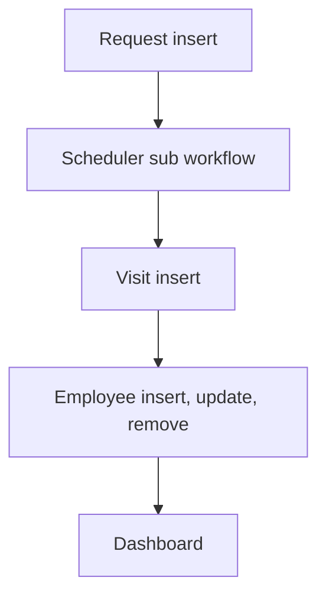

# Field Service

App baseline: what the Neome App gives out of the box, learnt from NA-field-service.

## Gives

- Admin keeps lists of service types (with SLA hours), territories, priorities and customers.
- Admin keeps employees; adding one creates an app user, role or status change updates it, removal deletes it.
- Manager or admin raises a service request for a customer, with type, territory, priority and assignee.
- Escalation time is worked out from request time and SLA hours.
- Manager and assignee get a message while the request is open.
- Technician logs a visit on a request with place, photo, resolution note and customer signature.
- Saving a visit updates the linked request.
- Resolution hours are worked out on request and visit.
- Monthly dashboard shows total requests, total visits and SLA breaches.

## Sheets, key fields, roles

- ServiceType: ServiceType, SLAHours
- Territory: Territory, Manager @ServiceManager
- Customer: CustomerName, MobileNumber, Email, Address
- Employee: EmployeeName, Employee user, Roles, RefTerritory →Territory, Status {pickText}
- ServiceRequest: RefCustomer →Customer, RefServiceType →ServiceType, RefTerritory →Territory, RefServicePriority →ServicePriority, AssignedTo, Status {pickText}, EscalateDateTime
- ServiceVisit: RefServiceRequest →ServiceRequest, Location, ResolutionDateTime, ResolutionImage, CustomerSignature
- Roles: ServiceTechnician, ServiceManager, OrganizationAdmin.

## Workflows

- Request insert: escalation time from SLA hours; per-row scheduler starts.
- Scheduler sub workflow: while request is open, manager and assignee are messaged.
- Visit insert: linked request row is updated; resolution hours worked out.
- Employee insert, update, remove: app user kept in step with the row.
- Dashboard: monthly requests, visits and SLA breaches.

## Flowchart

