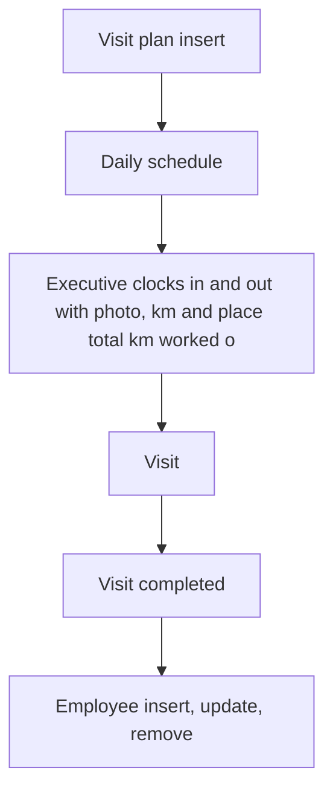

# Field Visit Management

App baseline: what the Neome App gives out of the box, learnt from NA-field-visit-management.

## Gives

- Admin keeps visit types, priorities, territories, expense categories, customers and employees.
- Manager plans visits for an executive; executive is reminded before the visit.
- Executive clocks in and out daily with photo, km and location.
- Executive logs visit with photos, expenses, feedback and follow-up.
- Completed visit marks the plan complete.
- Dashboard of today's visits, productivity, visit map and visit frequency.
- Employee row creates and updates the app user.

## Sheets, key fields, roles

- VisitPlanning: Customer →Customer, Priority →Priority, Status {Pending|In Progress|Completed}, AssignedTo @FieldExecutive
- Visit: VisitPlan →VisitPlanning, VisitType →VisitType, VisitStatus {Pending|In Progress|Completed}, Expense grid, Feedback
- Attendance: ClockIn, StartKm, ClockOut, EndKm, TotalKm
- Customer: CustomerName, Location, Territory →Territory
- Employee: Roles, Manager, Territory →Territory, Status
- Roles: OrganizationAdmin, FieldManager, FieldExecutive.

## Workflows

- Visit plan insert: scheduler messages the executive 30 and 15 minutes before.
- Daily schedule: attendance row made for each executive.
- Executive clocks in and out with photo, km and place; total km worked out.
- Visit: distance check warns when too far from the planned place; expense lines summed.
- Visit completed: sub workflow marks the plan complete.
- Employee insert, update, remove: app user kept in step with the row.

## Flowchart

