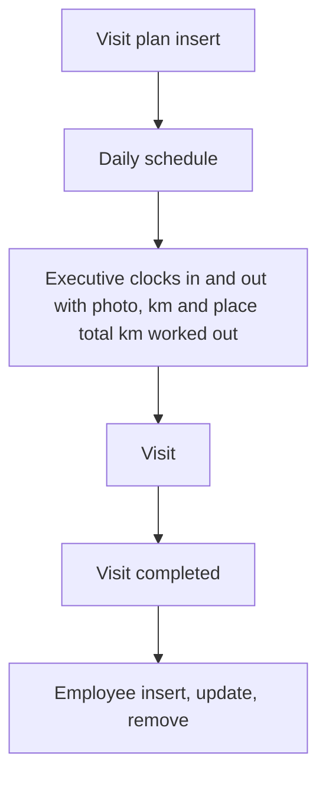

# Field Visit Management

App baseline: what the Neome App gives out of the box, learnt from NA-field-visit-management.

## Gives

- Admin keeps visit types, priorities, territories, expense categories, customers and employees.
- Manager plans visits for an executive; executive is reminded before the visit.
- Executive clocks in and out daily with photo, km and location.
- Executive logs visit with photos, expenses, feedback and follow-up.
- Completed visit marks the plan complete.
- Dashboard of today's visits, productivity, visit map and visit frequency.
- Employee row creates and updates the app user.

## Sheets, key fields, roles

- VisitPlanning: Customer →Customer, Priority →Priority, Status {Pending|In Progress|Completed}, AssignedTo @FieldExecutive
- Visit: VisitPlan →VisitPlanning, VisitType →VisitType, VisitStatus {Pending|In Progress|Completed}, Expense grid, Feedback
- Attendance: ClockIn, StartKm, ClockOut, EndKm, TotalKm
- Customer: CustomerName, Location, Territory →Territory
- Employee: Roles, Manager, Territory →Territory, Status
- Roles: OrganizationAdmin, FieldManager, FieldExecutive.

## Workflows

- Visit plan insert: scheduler messages the executive 30 and 15 minutes before.
- Daily schedule: attendance row made for each executive.
- Executive clocks in and out with photo, km and place; total km worked out.
- Visit: distance check warns when too far from the planned place; expense lines summed.
- Visit completed: sub workflow marks the plan complete.
- Employee insert, update, remove: app user kept in step with the row.

## Flowchart

## Execute

Only use this to apply this into a Studio Enterprise via MCP.

Only if Neome App field-visit-management is not installed (check `list` first): rebuild what Gives lists. If installed, reuse it and build only gaps.

Placeholders: VisitPlanningSheet, VisitSheet, AttendanceSheet, VarPlanStatus. Needs first: none.

1. Roles: `add kind=role name=OrganizationAdmin|FieldManager|FieldExecutive details={}`.
2. Vars: `add kind=var kind=setOfText name=VarPlanStatus deploy=fixedOnDeploy value={"Pending":{},"In Progress":{},"Completed":{}}` (VisitPlanning Status and Visit VisitStatus).
3. Master sheets (`apply PAT-admin-kept-pick-list Execute`): VisitType, Priority, Territory, ExpenseCategory, Customer (+ `type=location`, `type=ref Territory`). Employee via `apply PAT-sheet-row-drives-app-user Execute`.
4. VisitPlanningForm → VisitPlanningSheet: `type=ref Customer`, `type=ref Priority`, `type=pickText Status source=VarPlanStatus` {Pending|In Progress|Completed}, `type=pickUser AssignedTo`; table layout.
5. VisitForm → VisitSheet: `type=ref VisitPlan`, `type=ref VisitType`, `type=pickText VisitStatus source=VarPlanStatus`, visit photos `type=camera`, `type=paragraph Feedback`, Expense `type=grid` composite (ref ExpenseCategory + `type=currency Amount`).
6. AttendanceForm → AttendanceSheet: ClockIn / ClockOut `type=dateTime`, StartKm / EndKm `type=number`, TotalKm via `add kind=formFormula`; `apply PAT-clock-in-out-with-photo Execute` (photo + `type=location captureMode=onInsert`).
7. Reminders: `apply PAT-per-row-scheduler Execute` on VisitPlanning insert → `sendMessageToUsers` 30 and 15 min before (`apply PAT-scheduled-reminder-message Execute`).
8. Daily: `apply PAT-scheduled-job-over-rows Execute` — `kind=eventSchedule repeatSetting` → `kind=branchIterateSpreadsheet spreadsheet=EmployeeSheet` → `kind=rowInsert spreadsheet=AttendanceSheet` per executive.
9. Visit save: expense total `add kind=formFormula`; far-from-place warning via `apply PAT-error-field-check Execute`; VisitStatus Completed → `apply PAT-update-linked-rows Execute` (`rowUpdate` the plan to Completed).
10. Dashboard: `apply PAT-composite-report Execute` + `add kind=spreadsheetLayout kind=map locationField` for the visit map; `set kind=group actionPermissionMap`; `validate` till ok=true.

Gaps: per-row scheduler `scheduleTrigger` binder (verify: describe); distance rule source per Enterprise.
