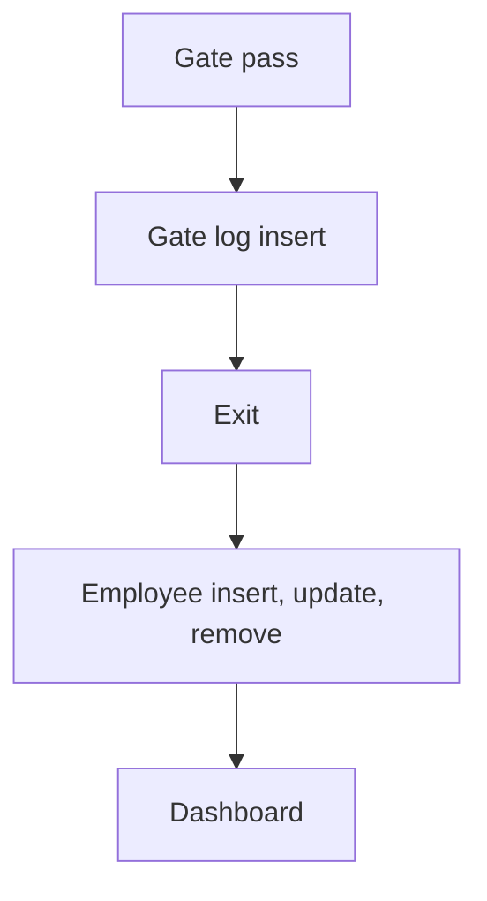

# Gate Pass Management

App baseline: what the Neome App gives out of the box, learnt from NA-gate-pass-management.

## Gives

- Admin keeps gate pass types and employees (users added, updated, removed with the row).
- Store executive raises a gate pass for a driver and vehicle, with type picked from list.
- Security logs vehicle entry and exit with photos; stayed hours worked out.
- Dashboard shows total active passes and today's gate log.

## Sheets, key fields, roles

- GatePassType: GatePassType
- GatePass: Date, GatePassId, RefGateType →GatePassType, DriverName, DriverMobile, VehicleNumber, Status
- GateLog: RefGatePass →GatePass, Entry, EntryImage, EnableExit, Exit, ExitImage, StayedHours
- Employee: EmployeeName, Employee @Security, Roles, Manager, Status
- Roles: StoreExecutive, OperationsManager, Security, OrganizationAdmin.

## Workflows

- Gate pass: store executive raises it; pass ID made; form locks by status.
- Gate log insert: entry time and photo; linked gate pass row updated.
- Exit: exit time and photo; stayed hours worked out.
- Employee insert, update, remove: app user kept in step with the row.
- Dashboard: active passes and today's gate log.

## Flowchart

