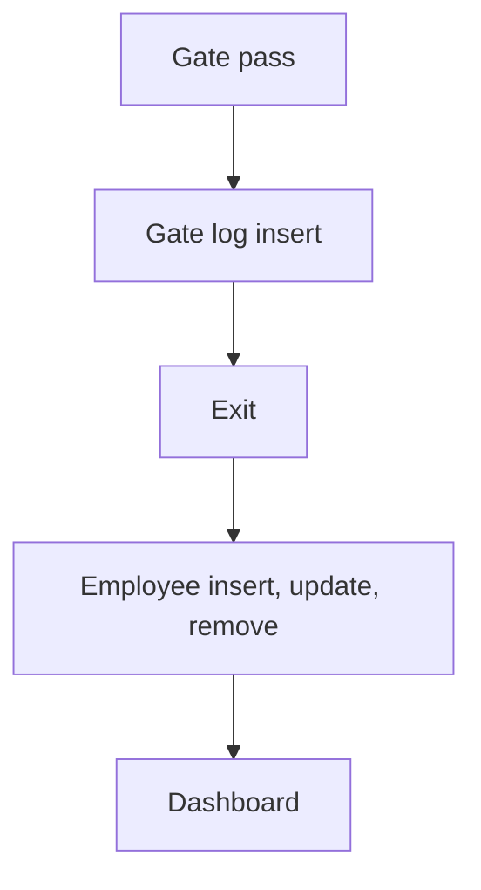

# Gate Pass Management

App baseline: what the Neome App gives out of the box, learnt from NA-gate-pass-management.

## Gives

- Admin keeps gate pass types and employees (users added, updated, removed with the row).
- Store executive raises a gate pass for a driver and vehicle, with type picked from list.
- Security logs vehicle entry and exit with photos; stayed hours worked out.
- Dashboard shows total active passes and today's gate log.

## Sheets, key fields, roles

- GatePassType: GatePassType
- GatePass: Date, GatePassId, RefGateType →GatePassType, DriverName, DriverMobile, VehicleNumber, Status
- GateLog: RefGatePass →GatePass, Entry, EntryImage, EnableExit, Exit, ExitImage, StayedHours
- Employee: EmployeeName, Employee @Security, Roles, Manager, Status
- Roles: StoreExecutive, OperationsManager, Security, OrganizationAdmin.

## Workflows

- Gate pass: store executive raises it; pass ID made; form locks by status.
- Gate log insert: entry time and photo; linked gate pass row updated.
- Exit: exit time and photo; stayed hours worked out.
- Employee insert, update, remove: app user kept in step with the row.
- Dashboard: active passes and today's gate log.

## Flowchart

## Execute

Only use this to apply this into a Studio Enterprise via MCP.

Only if Neome App gate-pass-management is not installed (check `list` first): rebuild what Gives lists. If installed, reuse it and build only gaps.

Placeholders: GatePassSheet, GateLogSheet, VarPassStatus. Needs first: none.

1. Roles: `add kind=role name=StoreExecutive|OperationsManager|Security|OrganizationAdmin details={}`.
2. GatePassType: `apply PAT-admin-kept-pick-list Execute`. Employee: `apply PAT-sheet-row-drives-app-user Execute`.
3. GatePassForm → GatePassSheet: `type=date Date`, `type=identifier GatePassId` (`apply PAT-generated-id Execute`), `type=ref GateType`, `type=text DriverName`, `type=mobileNumber DriverMobile`, `type=text VehicleNumber`, `type=pickText Status source=VarPassStatus`; `set kind=spreadsheet ref=GatePassSheet queryables` add Status. Lock after issue: `apply PAT-lock-fields-by-visibility Execute`.
4. GateLogForm → GateLogSheet: `type=ref GatePass`, `type=dateTime Entry`, `type=camera EntryImage`, `type=bool EnableExit`, `type=dateTime Exit`, `type=camera ExitImage`, `type=number StayedHours`.
5. Stayed hours: `add kind=formFormula assignToField=StayedHours formula={value:"…Exit − Entry…"}` (`apply PAT-calculated-field Execute`).
6. Log insert: `add kind=workflow` — `kind=eventSsInsertAfter spreadsheet=GateLogSheet` → `kind=branchIfElse option=Condition condition={statement:{lhs:"EnableExit",operator:"hasValue"}}` → `kind=rowUpdate rowIdPointer={spreadsheet:GatePassSheet,row:<from ref>}` sets Status; edges NEXT / TRUE / FALSE (verify: describe).
7. Dashboard: `apply PAT-composite-report Execute` (active passes; today's gate log via `add kind=report kind=spreadsheet filterCondition`); `add kind=action kind=report` + `set kind=group actionPermissionMap`.
8. `validate` till ok=true.

Gaps: edgeMap entry keys and ref-row binder (verify: describe); pass-id format per Enterprise.
