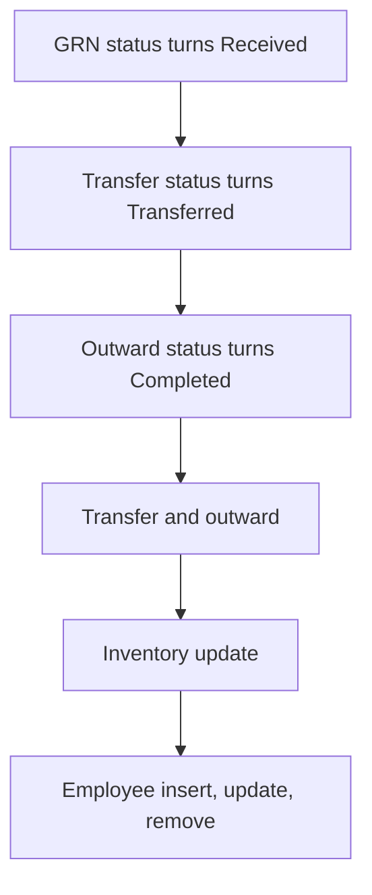

# Inventory & Stock Management

App baseline: what the Neome App gives out of the box, learnt from NA-inventory-and-stock-management.

## Gives

- Admin keeps masters for category, unit, vendor, warehouse, product and employee.
- Employee row creates and manages the app user and role.
- GRN with product grid; Received adds stock to the warehouse.
- Transfer between warehouses; Transferred moves stock; blocks above available.
- Outward from a warehouse; Completed reduces stock; blocks above available.
- Inventory sheet shows available quantity per warehouse and product.
- Low stock and safety stock messages to groups.
- Stock ledger report with date and warehouse filter.
- Inventory dashboard with SKU, low, critical and zero stock counts.
- Master data menu report.

## Sheets, key fields, roles

- Product: Image, ProductName*, Category ⇐ RefProductCategory, Unit ⇐ RefUnitOfMeasurement, ReorderLevel, SafetyStock
- GRN: Warehouse →Warehouse, Vendor →Vendor, Products grid (ReceivedQuantity), TotalQuantity, Status {Pending|Received|Cancelled}
- Inventory: Warehouse →Warehouse, Product →Product, AvailableQuantity logDecimal
- Transfer: From warehouse →Warehouse, To warehouse →Warehouse, Products grid (QuantityToTransfer), Status {Pending|Transferred|Cancelled}, Error
- Outward: Warehouse →Warehouse, Products grid (OutwardQuantity), Status {Pending|Completed|Cancelled}, Error
- Employee: EmployeeName*, Handle*, Roles setOfRole*, Status pickText*
- Roles: InventoryExecutive, OperationsManager, DepartmentManager, OrganizationAdmin.

## Workflows

- GRN status turns Received: grid lines add quantity to the warehouse stock row, or insert it.
- Transfer status turns Transferred: quantity moves from one warehouse to the other.
- Outward status turns Completed: quantity goes down.
- Transfer and outward: products picked from warehouse stock report; error shown and send disabled above available stock.
- Inventory update: message to groups when below reorder level or safety stock.
- Employee insert, update, remove: app user kept in step with the row.

## Flowchart

## Execute

Only use this to apply this into a Studio Enterprise via MCP.

Only if Neome App inventory-and-stock-management is not installed (check `list` first): rebuild what Gives lists. If installed, reuse it and build only gaps.

Placeholders: InventorySheet, GrnSheet, TransferSheet, OutwardSheet, VarGrnStatus. Needs first: none.

1. Roles: `add kind=role name=InventoryExecutive|OperationsManager|DepartmentManager|OrganizationAdmin details={}`.
2. Vars: `add kind=var kind=setOfText name=VarGrnStatus deploy=fixedOnDeploy value={"Pending":{},"Received":{},"Cancelled":{}}`.
3. Masters (`apply PAT-admin-kept-pick-list Execute`): ProductCategory, UnitOfMeasurement, Vendor, Warehouse, Product (+ `type=number ReorderLevel`, `type=number SafetyStock`); Employee via `apply PAT-sheet-row-drives-app-user Execute`.
4. InventoryForm → InventorySheet: `type=ref Warehouse`, `type=ref Product`, `type=logDecimal AvailableQuantity`; `add kind=spreadsheet` with `uniqueIndexs` Warehouse+Product, `uniquenessMode=combined` (`apply PAT-running-total-by-log-field Execute`).
5. GRN (`apply PAT-line-items-grid-with-totals Execute`): Warehouse + Vendor `type=ref`, Products `type=grid` (ref Product + `type=number ReceivedQuantity`), TotalQuantity, `type=pickText Status source=VarGrnStatus` {Pending|Received|Cancelled}.
6. Transfer / Outward: same grid pattern (QuantityToTransfer / OutwardQuantity), From / To `type=ref Warehouse`, Error field via `apply PAT-error-field-check Execute`.
7. Stock moves: `apply PAT-stock-moves-by-workflow Execute` — per sheet `kind=eventSsUpdateAfter` → `kind=branchIfElse` status changed → `kind=branchSwitchCase field={param:"$Curr",field:"Status"}` → `kind=branchIterateGrid grid=Products` → `kind=rowUpdate rowIdPointer={spreadsheet:InventorySheet,row:…}` add on Received, subtract on Transferred / Completed; VALUE edges per option key.
8. Block above available: `apply PAT-stop-save-by-workflow-check Execute` (validate → stopAndError) or hide send when Error set.
9. Alerts: `apply PAT-low-stock-alert Execute` — inventory update → `branchIfElse` below ReorderLevel / SafetyStock → `sendMessageToGroups`.
10. Reports + menu: stock ledger `apply PAT-query-report-with-filter Execute`, dashboard `apply PAT-composite-report Execute`, masters menu `apply PAT-action-set-menu Execute`; `set kind=group actionPermissionMap`; `validate` till ok=true.

Gaps: grid-line row binder and log-field update shape (verify: describe); report filter mapping per Enterprise.
