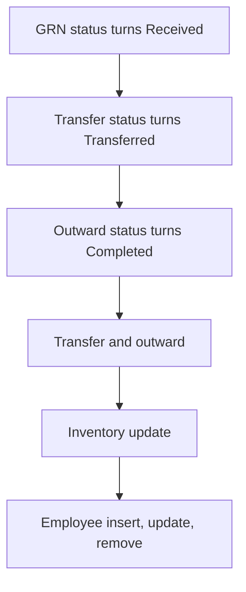

# Inventory & Stock Management

App baseline: what the Neome App gives out of the box, learnt from NA-inventory-and-stock-management.

## Gives

- Admin keeps masters for category, unit, vendor, warehouse, product and employee.
- Employee row creates and manages the app user and role.
- GRN with product grid; Received adds stock to the warehouse.
- Transfer between warehouses; Transferred moves stock; blocks above available.
- Outward from a warehouse; Completed reduces stock; blocks above available.
- Inventory sheet shows available quantity per warehouse and product.
- Low stock and safety stock messages to groups.
- Stock ledger report with date and warehouse filter.
- Inventory dashboard with SKU, low, critical and zero stock counts.
- Master data menu report.

## Sheets, key fields, roles

- Product: Image, ProductName*, Category ⇐ RefProductCategory, Unit ⇐ RefUnitOfMeasurement, ReorderLevel, SafetyStock
- GRN: Warehouse →Warehouse, Vendor →Vendor, Products grid (ReceivedQuantity), TotalQuantity, Status {Pending|Received|Cancelled}
- Inventory: Warehouse →Warehouse, Product →Product, AvailableQuantity logDecimal
- Transfer: From warehouse →Warehouse, To warehouse →Warehouse, Products grid (QuantityToTransfer), Status {Pending|Transferred|Cancelled}, Error
- Outward: Warehouse →Warehouse, Products grid (OutwardQuantity), Status {Pending|Completed|Cancelled}, Error
- Employee: EmployeeName*, Handle*, Roles setOfRole*, Status pickText*
- Roles: InventoryExecutive, OperationsManager, DepartmentManager, OrganizationAdmin.

## Workflows

- GRN status turns Received: grid lines add quantity to the warehouse stock row, or insert it.
- Transfer status turns Transferred: quantity moves from one warehouse to the other.
- Outward status turns Completed: quantity goes down.
- Transfer and outward: products picked from warehouse stock report; error shown and send disabled above available stock.
- Inventory update: message to groups when below reorder level or safety stock.
- Employee insert, update, remove: app user kept in step with the row.

## Flowchart

