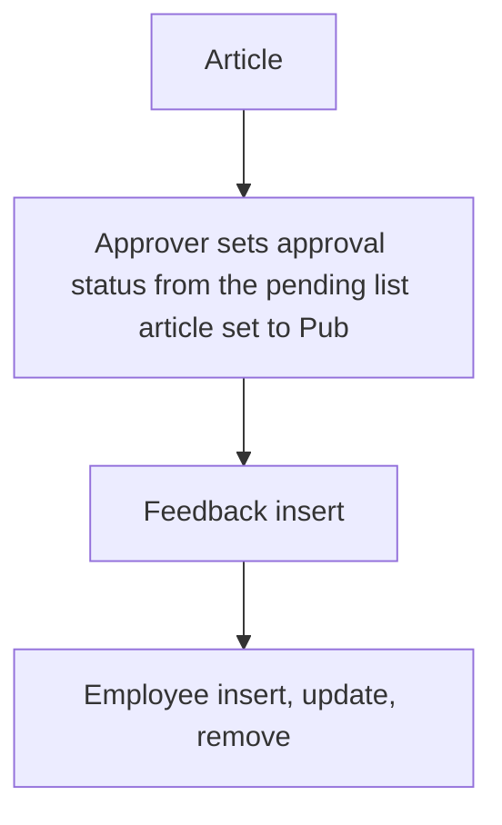

# Knowledge Library

App baseline: what the Neome App gives out of the box, learnt from NA-knowledge-library.

## Gives

- Admin keeps article categories.
- Content creator writes articles with category, version, content and attachments.
- Article has approval status and Draft or Publish status; approver and published lists are separate views.
- Viewer rates an article and leaves feedback; average rating shows on the article.
- Admin keeps staff list; adding, changing roles or manager, and status change update the app user.

## Sheets, key fields, roles

- ArticleCategory: Category
- Article: Title, RefArticleCategory →ArticleCategory, Version, ApprovalStatus, Status {Draft|Publish}, Content, Attachments, NoOfRatings, TotalRatings, AvgRatings
- ArticleFeedback: ArticleId →Article, Rating, Feedback
- Employee: EmployeeName, Employee (user), Roles, Manager, Status
- Roles: ContentCreator, Approver, OrganizationAdmin, Viewer.

## Workflows

- Article: creator adds it with category, version, content and files.
- Approver sets approval status from the pending list; article set to Publish.
- Feedback insert: rating count and total go up on the article; average worked out.
- Employee insert, update, remove: app user kept in step with the row.

## Flowchart

