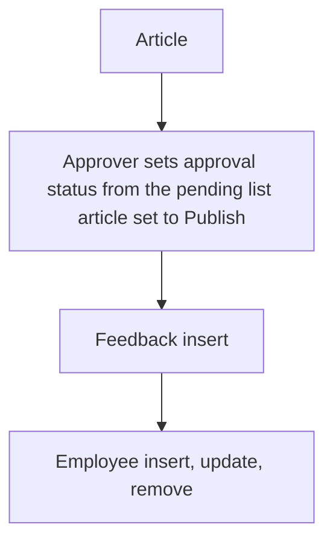

# Knowledge Library

App baseline: what the Neome App gives out of the box, learnt from NA-knowledge-library.

## Gives

- Admin keeps article categories.
- Content creator writes articles with category, version, content and attachments.
- Article has approval status and Draft or Publish status; approver and published lists are separate views.
- Viewer rates an article and leaves feedback; average rating shows on the article.
- Admin keeps staff list; adding, changing roles or manager, and status change update the app user.

## Sheets, key fields, roles

- ArticleCategory: Category
- Article: Title, RefArticleCategory →ArticleCategory, Version, ApprovalStatus, Status {Draft|Publish}, Content, Attachments, NoOfRatings, TotalRatings, AvgRatings
- ArticleFeedback: ArticleId →Article, Rating, Feedback
- Employee: EmployeeName, Employee (user), Roles, Manager, Status
- Roles: ContentCreator, Approver, OrganizationAdmin, Viewer.

## Workflows

- Article: creator adds it with category, version, content and files.
- Approver sets approval status from the pending list; article set to Publish.
- Feedback insert: rating count and total go up on the article; average worked out.
- Employee insert, update, remove: app user kept in step with the row.

## Flowchart

## Execute

Only use this to apply this into a Studio Enterprise via MCP.

Only if Neome App knowledge-library is not installed (check `list` first): rebuild what Gives lists. If installed, reuse it and build only gaps.

Placeholders: ArticleSheet, ArticleFeedbackSheet, VarApprovalStatus, VarPublishStatus. Needs first: none.

1. Roles: `add kind=role name=ContentCreator|Approver|OrganizationAdmin|Viewer details={}`.
2. ArticleCategory: `apply PAT-admin-kept-pick-list Execute`. Employee: `apply PAT-sheet-row-drives-app-user Execute`.
3. Vars: `add kind=var kind=setOfText name=VarApprovalStatus deploy=fixedOnDeploy value={"Pending":{},"Approved":{},"Rejected":{}}`; `VarPublishStatus` {"Draft","Publish"}.
4. ArticleForm → ArticleSheet: `type=text Title required`, `type=ref ArticleCategory`, `type=text Version`, `type=pickText ApprovalStatus source=VarApprovalStatus`, `type=pickText Status source=VarPublishStatus`, `type=paragraph Content`, `type=setOfDocument Attachments`, `type=number NoOfRatings`, `type=number TotalRatings`, `type=decimal AvgRatings`; table layout.
5. ArticleFeedbackForm → ArticleFeedbackSheet: `type=ref Article`, `type=rating Rating`, `type=paragraph Feedback`.
6. Approval: `apply PAT-approval-by-status Execute`; Approver pending list via `apply PAT-role-views-of-one-sheet Execute`; Approved → `kind=rowUpdate` sets Status=Publish (`apply PAT-act-on-status-change Execute`).
7. Feedback insert: `kind=eventSsInsertAfter spreadsheet=ArticleFeedbackSheet` → `kind=rowUpdate rowIdPointer={spreadsheet:ArticleSheet,row:<from ref>}` bumps NoOfRatings / TotalRatings; `add kind=formFormula assignToField=AvgRatings` (`apply PAT-calculated-field Execute`).
8. Views: Approver and Published lists as `add kind=action kind=spreadsheetEditor layoutSpreadsheet=… filterCondition={cond,…}` per role.
9. `set kind=group actionPermissionMap` (roles on every entry); `validate` till ok=true.

Gaps: rating-count mapping in rowUpdate (verify: describe); list filter conditions per Enterprise.
