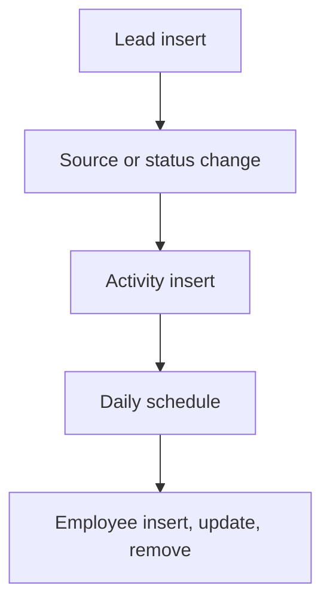

# Lead Management

App baseline: what the Neome App gives out of the box, learnt from NA-lead-management.

## Gives

- Sales staff add leads with source, contact, status and assignee.
- Source scoring rule gives a lead score when status or source changes.
- Activities (calls, follow-ups) log against a lead and count up on it.
- Assignee gets a message on assignment.
- Daily job messages a group about inactive leads.
- Lead dashboard and sales executive performance dashboard.
- Admin keeps sources, scoring rules, activity types and employees.
- Employee row adds, updates and removes the app user.

## Sheets, key fields, roles

- Lead: Company, Contact, Mobile, Source →Source, ScoreValue, AssignedTo @SalesExecutive, Status {New|Contacted|Follow-up|Meeting Scheduled|Demo Given|Proposal Sent|Negotiation|Qualified|Converted|Lost}
- Activity: Lead →Lead, ActivityType →ActivityType, DateOfFollowUp, Discussion, FollowUpDateTime
- ScoringRule: Source →Source, Status, Activities, ScoreValue
- Source: Source, ChannelType
- ActivityType: ActivityType
- Employee: Employee @SalesExecutive, Handle, Roles, Manager, Status
- Roles: SalesExecutive, SalesManager, DepartmentManager, OrganizationAdmin.

## Workflows

- Lead insert: assignee is messaged.
- Source or status change: score read from scoring rules and written to the lead.
- Activity insert: lead activity count goes up; reminders 30 and 15 minutes before follow-up.
- Daily schedule: group is messaged about inactive leads.
- Employee insert, update, remove: app user kept in step with the row.

## Flowchart

## Execute

Only use this to apply this into a Studio Enterprise via MCP.

Only if Neome App lead-management is not installed (check `list` first): rebuild what Gives lists. If installed, reuse it and build only gaps.

Placeholders: LeadSheet, ActivitySheet, ScoringRuleSheet, VarLeadStatus. Needs first: none.

1. Roles: `add kind=role name=SalesExecutive|SalesManager|DepartmentManager|OrganizationAdmin details={}`.
2. Masters (`apply PAT-admin-kept-pick-list Execute`): Source (+ ChannelType), ActivityType; ScoringRuleForm → ScoringRuleSheet (ref Source, Status, `type=number Activities`, `type=number ScoreValue`). Employee via `apply PAT-sheet-row-drives-app-user Execute`.
3. LeadForm → LeadSheet: `type=text Company`, `type=text Contact`, `type=mobileNumber Mobile`, `type=ref Source`, `type=number ScoreValue`, `type=pickUser AssignedTo`, `type=pickText Status source=VarLeadStatus` (option keys New, Contacted, FollowUp, MeetingScheduled, DemoGiven, ProposalSent, Negotiation, Qualified, Converted, Lost); `set kind=spreadsheet ref=LeadSheet queryables` add Status.
4. ActivityForm → ActivitySheet: `type=ref Lead`, `type=ref ActivityType`, `type=date DateOfFollowUp`, `type=paragraph Discussion`, `type=dateTime FollowUpDateTime` (`apply PAT-follow-up-log Execute`).
5. Lead insert: `kind=eventSsInsertAfter spreadsheet=LeadSheet` → `kind=sendMessageToUsers message toUsers` to AssignedTo (`apply PAT-message-on-event Execute`).
6. Score: `apply PAT-act-on-status-change Execute` — `kind=eventSsUpdateAfter spreadsheet=LeadSheet` → `branchIfElse` Source or Status changed → `kind=ssSearchRows spreadsheet=ScoringRuleSheet filterCondition` → `kind=fieldSet outputField` ScoreValue (verify: describe).
7. Activity insert: `kind=eventSsInsertAfter` → `kind=rowUpdate rowIdPointer={spreadsheet:LeadSheet,row:<from ref>}` bumps the activity count; reminders 30 + 15 min before via `apply PAT-scheduled-reminder-message Execute`.
8. Daily: `apply PAT-scheduled-job-over-rows Execute` — `kind=eventSchedule` → `branchIterateSpreadsheet` leads → `branchIfElse` inactive → `kind=sendMessageToGroups toGroups`.
9. Dashboards: `apply PAT-composite-report Execute` (leads + executive performance); `set kind=group actionPermissionMap`; `validate` till ok=true.

Gaps: ssSearchRows output into fieldSet binder (verify: describe); inactive-lead rule per Enterprise.
