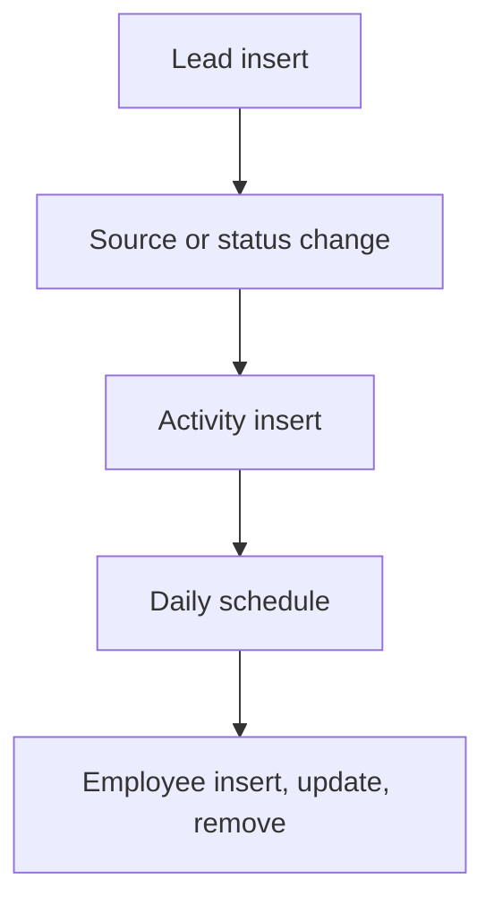

# Lead Management

App baseline: what the Neome App gives out of the box, learnt from NA-lead-management.

## Gives

- Sales staff add leads with source, contact, status and assignee.
- Source scoring rule gives a lead score when status or source changes.
- Activities (calls, follow-ups) log against a lead and count up on it.
- Assignee gets a message on assignment.
- Daily job messages a group about inactive leads.
- Lead dashboard and sales executive performance dashboard.
- Admin keeps sources, scoring rules, activity types and employees.
- Employee row adds, updates and removes the app user.

## Sheets, key fields, roles

- Lead: Company, Contact, Mobile, Source →Source, ScoreValue, AssignedTo @SalesExecutive, Status {New|Contacted|Follow-up|Meeting Scheduled|Demo Given|Proposal Sent|Negotiation|Qualified|Converted|Lost}
- Activity: Lead →Lead, ActivityType →ActivityType, DateOfFollowUp, Discussion, FollowUpDateTime
- ScoringRule: Source →Source, Status, Activities, ScoreValue
- Source: Source, ChannelType
- ActivityType: ActivityType
- Employee: Employee @SalesExecutive, Handle, Roles, Manager, Status
- Roles: SalesExecutive, SalesManager, DepartmentManager, OrganizationAdmin.

## Workflows

- Lead insert: assignee is messaged.
- Source or status change: score read from scoring rules and written to the lead.
- Activity insert: lead activity count goes up; reminders 30 and 15 minutes before follow-up.
- Daily schedule: group is messaged about inactive leads.
- Employee insert, update, remove: app user kept in step with the row.

## Flowchart

