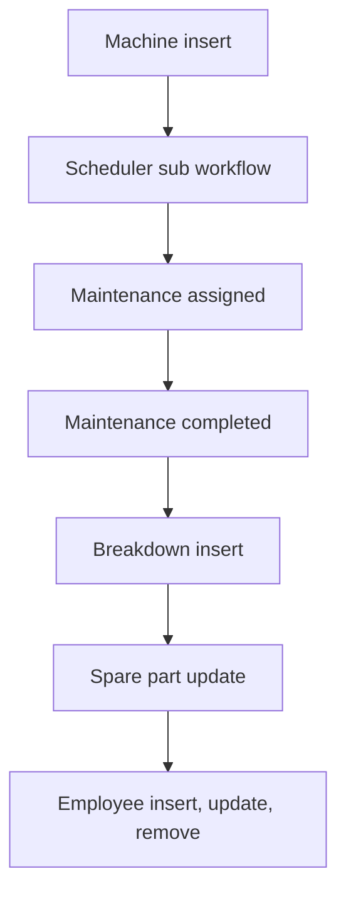

# Machine / Tools Maintenance

App baseline: what the Neome App gives out of the box, learnt from NA-machine-tools-maintenance.

## Gives

- Admin keeps machine, machine category, maintenance type and spare part masters.
- Each machine has a maintenance frequency; next maintenance date and reminder date are worked out.
- A scheduled maintenance row is created for the machine and the technician is told.
- Manager assigns a technician; technician completes maintenance with spare parts used and checklist.
- On completion, last maintenance date, breakdown hours and spare part stock are updated.
- Technician or manager logs a breakdown; machine goes to breakdown status and group is told.
- On resolve, machine is available again and downtime hours are added to the machine.
- Employee row adds, updates and deactivates the app user with role and manager.
- Group is told when a spare part falls to its reorder quantity.
- Dashboard shows total machines, breakdowns, maintenance, cost and active breakdowns for a date range.
- Master data screen with buttons to each master.

## Sheets, key fields, roles

- Machine: MachineCode, Category →MachineCategory, Location, InstallationDate, MaintenanceFrequency, NextMaintenanceDate, RemainderDate, Priority, Status, TotalBreakdownHr
- Maintenance: Machine →Machine, MaintenanceType →MaintenanceType, AssignedTo @MaintenanceTechnician, Cost, DowntimeHours, Status, SpareParts grid, Checklist grid
- Breakdown: Machine →Machine, ReportedOn, Status, ResolvedBy @MaintenanceTechnician, ResolvedOn, DowntimeHours, RootCauseAnalysis
- SparePart: PartName, AvailableQuantity, ReorderQuantity
- MachineCategory: MachineCategory
- MaintenanceType: MaintenanceType
- Employee: EmployeeName, Roles, Manager @MaintenanceManager, Status
- Roles: MaintenanceTechnician, MaintenanceManager, OrganizationAdmin.

## Workflows

- Machine insert: next maintenance and reminder dates worked out; per-row scheduler set.
- Scheduler sub workflow: scheduled maintenance row added; technician told.
- Maintenance assigned: technician messaged; checklist loaded from the machine.
- Maintenance completed: last maintenance date set; spare part stock goes down; downtime added to the machine.
- Breakdown insert: machine set to breakdown; group told. Resolve: machine available, downtime added, row locked.
- Spare part update: group told at reorder quantity.
- Employee insert, update, remove: app user kept in step with the row.

## Flowchart

## Execute

Only use this to apply this into a Studio Enterprise via MCP.

Only if Neome App machine-tools-maintenance is not installed (check `list` first): rebuild what Gives lists. If installed, reuse it and build only gaps.

Placeholders: MachineSheet, MaintenanceSheet, BreakdownSheet, SparePartSheet. Needs first: none.

1. Roles: `add kind=role name=MaintenanceTechnician|MaintenanceManager|OrganizationAdmin details={}`.
2. Masters (`apply PAT-admin-kept-pick-list Execute`): MachineCategory, MaintenanceType, SparePart (`type=logDecimal AvailableQuantity`, `type=number ReorderQuantity`); Employee via `apply PAT-sheet-row-drives-app-user Execute`.
3. MachineForm → MachineSheet: `type=text MachineCode`, `type=ref Category`, `type=location Location`, `type=date InstallationDate`, `type=number MaintenanceFrequency`, NextMaintenanceDate + RemainderDate `type=date` via `add kind=formFormula`, `type=pickText Status`, `type=number TotalBreakdownHr`.
4. MaintenanceForm → MaintenanceSheet: `type=ref Machine`, `type=ref MaintenanceType`, `type=pickUser AssignedTo`, `type=currency Cost`, `type=number DowntimeHours`, `type=pickText Status`, SpareParts and Checklist `type=grid` composites.
5. BreakdownForm → BreakdownSheet: `type=ref Machine`, `type=dateTime ReportedOn`, `type=pickText Status`, `type=pickUser ResolvedBy`, `type=dateTime ResolvedOn`, `type=number DowntimeHours`, `type=paragraph RootCauseAnalysis`.
6. Machine insert: dates via `apply PAT-calculated-field Execute`; per-row scheduler via `apply PAT-per-row-scheduler Execute` — scheduler node → `kind=rowInsert spreadsheet=MaintenanceSheet` (scheduled row) → `kind=sendMessageToUsers` technician (`apply PAT-message-on-event Execute`).
7. Maintenance completed: `apply PAT-act-on-status-change Execute` → `apply PAT-update-linked-rows Execute` (machine last maintenance date + breakdown hours) + `apply PAT-stock-moves-by-workflow Execute` (spare part stock down per grid line, `kind=branchIterateGrid`).
8. Breakdown: insert → machine Status = Breakdown + `kind=sendMessageToGroups toGroups`; resolve → machine available, downtime added, row locked (`apply PAT-lock-fields-by-visibility Execute`).
9. Spare part update: `apply PAT-low-stock-alert Execute` at ReorderQuantity.
10. Dashboard `apply PAT-composite-report Execute`; master data screen via `apply PAT-button-runs-workflow Execute`; `set kind=group actionPermissionMap`; `validate` till ok=true.

Gaps: per-row scheduler `scheduleTrigger` binder and grid-line rowUpdate binder (verify: describe).
