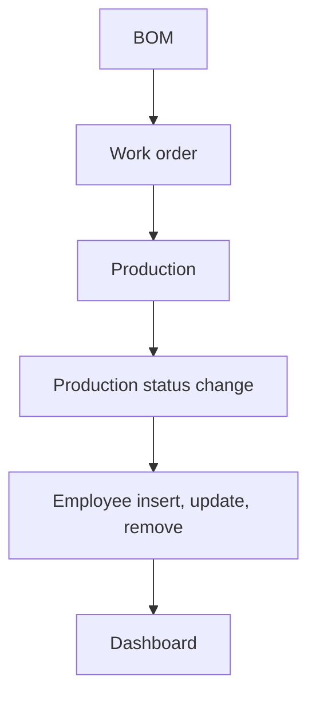

# Manufacturing

App baseline: what the Neome App gives out of the box, learnt from NA-manufacturing.

## Gives

- Admin keeps masters for employees, product categories, units, products, raw materials and work centers.
- Employee row adds, updates and removes the app user; role, manager and status changes follow.
- Ops manager defines a BOM per product with raw material lines and required qty.
- Work order picks a BOM and work center, with planned qty, dates and status.
- Work order moving to Released messages the creator.
- Production entry picks a work center and work order, with consumed qty per raw material.
- Production status change updates the linked work order status.
- Production shows a delay value and an error check; form locks by flags.
- Manufacturing dashboard by date range, with active, delayed and WIP orders and counts by status and work center.
- Master data menu opens each master list.

## Sheets, key fields, roles

- Product: ProductName, ProductCode, RefProductCategory →ProductCategory, RefUnitOfMeasurement →UnitOfMeasurement
- RawMaterial: MaterialName, RefUnitOfMeasurement →UnitOfMeasurement
- WorkCenter: WorkCenter, Capacity
- BOM: RefProduct →Product, Version, IsActive {Yes|No}, grid of RefRawMaterial →RawMaterial + RequiredQty
- WorkOrder: RefBOM →BOM, RefWorkCenter →WorkCenter, PlannedQty, StartDate, EndDate, Status {Draft|Released|In Progress|On Hold|Quality Check|Completed|Closed|Cancelled}
- Production: RefWorkCenter →WorkCenter, RefWorkOrder →WorkOrder, Status {Draft|Submitted|Approved|Sent to QC|Rejected|Rework|Closed}, grid of RefRawMaterial + RequiredQty + ConsumedQty
- Employee: Handle, Roles, Manager, Status {Active|Deactivate}
- Roles: ProductionExecutive, QualityInspector, OperationsManager, OrganizationAdmin.

## Workflows

- BOM: ops manager adds raw material lines with required qty per product.
- Work order: picks BOM and work center; Released messages the creator.
- Production: picks work order; consumed qty per raw material; delay and error worked out.
- Production status change: switch sets the linked work order status.
- Employee insert, update, remove: app user kept in step with the row.
- Dashboard: work orders and production by date range.

## Flowchart

