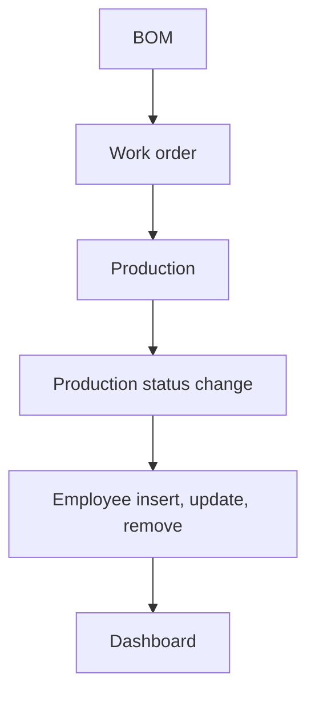

# Manufacturing

App baseline: what the Neome App gives out of the box, learnt from NA-manufacturing.

## Gives

- Admin keeps masters for employees, product categories, units, products, raw materials and work centers.
- Employee row adds, updates and removes the app user; role, manager and status changes follow.
- Ops manager defines a BOM per product with raw material lines and required qty.
- Work order picks a BOM and work center, with planned qty, dates and status.
- Work order moving to Released messages the creator.
- Production entry picks a work center and work order, with consumed qty per raw material.
- Production status change updates the linked work order status.
- Production shows a delay value and an error check; form locks by flags.
- Manufacturing dashboard by date range, with active, delayed and WIP orders and counts by status and work center.
- Master data menu opens each master list.

## Sheets, key fields, roles

- Product: ProductName, ProductCode, RefProductCategory →ProductCategory, RefUnitOfMeasurement →UnitOfMeasurement
- RawMaterial: MaterialName, RefUnitOfMeasurement →UnitOfMeasurement
- WorkCenter: WorkCenter, Capacity
- BOM: RefProduct →Product, Version, IsActive {Yes|No}, grid of RefRawMaterial →RawMaterial + RequiredQty
- WorkOrder: RefBOM →BOM, RefWorkCenter →WorkCenter, PlannedQty, StartDate, EndDate, Status {Draft|Released|In Progress|On Hold|Quality Check|Completed|Closed|Cancelled}
- Production: RefWorkCenter →WorkCenter, RefWorkOrder →WorkOrder, Status {Draft|Submitted|Approved|Sent to QC|Rejected|Rework|Closed}, grid of RefRawMaterial + RequiredQty + ConsumedQty
- Employee: Handle, Roles, Manager, Status {Active|Deactivate}
- Roles: ProductionExecutive, QualityInspector, OperationsManager, OrganizationAdmin.

## Workflows

- BOM: ops manager adds raw material lines with required qty per product.
- Work order: picks BOM and work center; Released messages the creator.
- Production: picks work order; consumed qty per raw material; delay and error worked out.
- Production status change: switch sets the linked work order status.
- Employee insert, update, remove: app user kept in step with the row.
- Dashboard: work orders and production by date range.

## Flowchart

## Execute

Only use this to apply this into a Studio Enterprise via MCP.

Only if Neome App manufacturing is not installed (check `list` first): rebuild what Gives lists. If installed, reuse it and build only gaps.

Placeholders: BomSheet, WorkOrderSheet, ProductionSheet, VarWoStatus, VarProdStatus. Needs first: none.

1. Roles: `add kind=role name=ProductionExecutive|QualityInspector|OperationsManager|OrganizationAdmin details={}`.
2. Vars: `add kind=var kind=setOfText deploy=fixedOnDeploy` VarWoStatus {Draft|Released|In Progress|On Hold|Quality Check|Completed|Closed|Cancelled}, VarProdStatus {Draft|Submitted|Approved|Sent to QC|Rejected|Rework|Closed}.
3. Masters (`apply PAT-admin-kept-pick-list Execute`): ProductCategory, UnitOfMeasurement, Product (refs), RawMaterial (`type=ref UnitOfMeasurement`), WorkCenter (+ `type=number Capacity`); Employee via `apply PAT-sheet-row-drives-app-user Execute`.
4. BOMForm → BOMSheet: `type=ref Product`, `type=text Version`, `type=bool IsActive showAsCheckbox`; Lines `type=grid` (ref RawMaterial + `type=number RequiredQty`) via `apply PAT-line-items-grid-with-totals Execute`.
5. WorkOrderForm → WorkOrderSheet: `type=ref BOM`, `type=ref WorkCenter`, `type=number PlannedQty`, `type=date StartDate`, `type=date EndDate`, `type=pickText Status source=VarWoStatus` (option keys Draft, Released, InProgress, OnHold, QualityCheck, Completed, Closed, Cancelled); `set kind=spreadsheet ref=WorkOrderSheet queryables` add Status.
6. ProductionForm → ProductionSheet: `type=ref WorkCenter`, `type=ref WorkOrder`, `type=pickText Status source=VarProdStatus`, grid (ref RawMaterial + RequiredQty + `type=number ConsumedQty`); Delay via `add kind=formFormula` (`apply PAT-calculated-field Execute`), Error field via `apply PAT-error-field-check Execute`, locks via `apply PAT-lock-fields-by-visibility Execute`.
7. Released: `apply PAT-message-on-event Execute` — `kind=eventSsUpdateAfter spreadsheet=WorkOrderSheet` → `kind=branchSwitchCase field={param:"$Curr",field:"Status"}` → VALUE keyReleased → `kind=sendMessageToUsers` to creator.
8. Production status change: `apply PAT-act-on-status-change Execute` → `apply PAT-update-linked-rows Execute` (`kind=rowUpdate rowIdPointer={spreadsheet:WorkOrderSheet,row:<from ref>}`) sets work order Status.
9. Dashboard: `apply PAT-composite-report Execute` (date-range input form, active / delayed / WIP orders, counts by Status and WorkCenter); masters menu via `apply PAT-action-set-menu Execute`; `set kind=group actionPermissionMap`; `validate` till ok=true.

Gaps: grid ref-row binder in rowUpdate (verify: describe); delay formula and dashboard report shapes per Enterprise.
