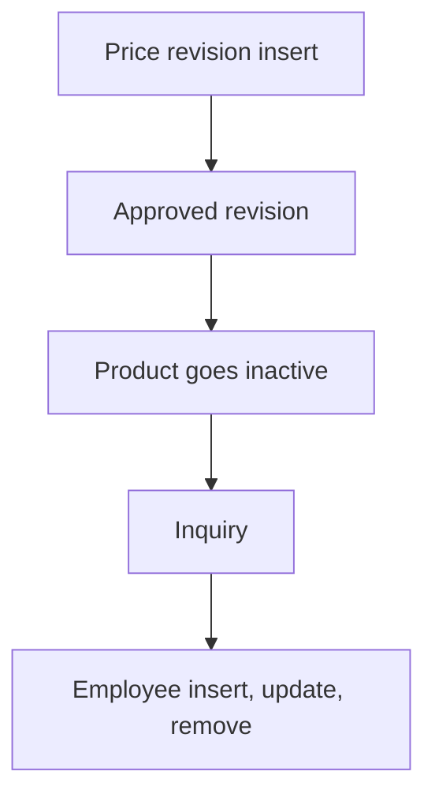

# Product Catalog & Inquiry

App baseline: what the Neome App gives out of the box, learnt from NA-product-catalog.

## Gives

- Admin keeps product master with category, sub category, type, unit and images.
- Product Master report opens each master list from one screen.
- Inventory exec raises price revision; manager approves; price applies on effective date.
- Price history view per product.
- Sales exec logs customer inquiry with product grid and quantity.
- Inquiry dashboard by date range.
- Admin adds employee; app user is made, updated and removed with the row.
- Push to creator on approval change; group message when product goes inactive.

## Sheets, key fields, roles

- Product: Name, Category →ProductCategory, SubCategory →ProductSubCategory, Type →ProductType, Unit →UnitOfMeasurement, CostPrice, Price, StockStatus, Status
- PriceRevision: Product →Product, NewSellingPrice, EffectiveDate, ApprovalStatus, ApprovedBy @Manager
- ProductInquiry: Name, MobileNumber, Email, InquiryStatus, Products grid →Product with Quantity
- Employee: Name, Roles, Manager, Handle, Status
- Roles: InventoryExecutive, SalesExecutive, Manager, OrganizationAdmin.

## Workflows

- Price revision insert: old price copied; manager approves; creator gets a push.
- Approved revision: per-row scheduler applies the new price to the product on the effective date.
- Product goes inactive: group message.
- Inquiry: sales exec adds customer and product grid with quantity.
- Employee insert, update, remove: app user kept in step with the row.

## Flowchart

