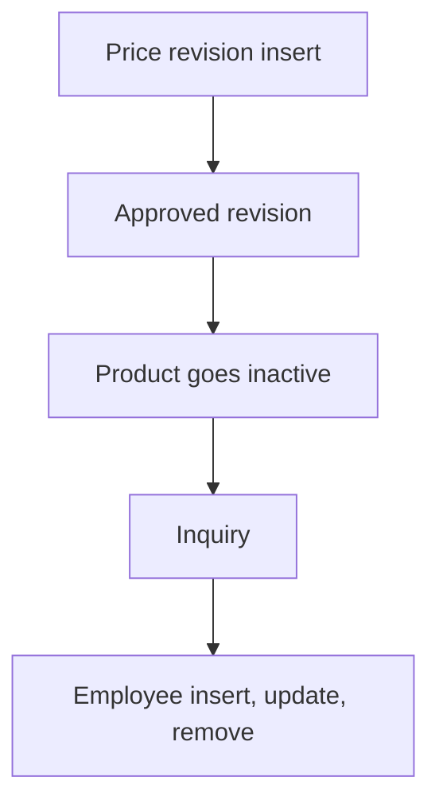

# Product Catalog & Inquiry

App baseline: what the Neome App gives out of the box, learnt from NA-product-catalog.

## Gives

- Admin keeps product master with category, sub category, type, unit and images.
- Product Master report opens each master list from one screen.
- Inventory exec raises price revision; manager approves; price applies on effective date.
- Price history view per product.
- Sales exec logs customer inquiry with product grid and quantity.
- Inquiry dashboard by date range.
- Admin adds employee; app user is made, updated and removed with the row.
- Push to creator on approval change; group message when product goes inactive.

## Sheets, key fields, roles

- Product: Name, Category →ProductCategory, SubCategory →ProductSubCategory, Type →ProductType, Unit →UnitOfMeasurement, CostPrice, Price, StockStatus, Status
- PriceRevision: Product →Product, NewSellingPrice, EffectiveDate, ApprovalStatus, ApprovedBy @Manager
- ProductInquiry: Name, MobileNumber, Email, InquiryStatus, Products grid →Product with Quantity
- Employee: Name, Roles, Manager, Handle, Status
- Roles: InventoryExecutive, SalesExecutive, Manager, OrganizationAdmin.

## Workflows

- Price revision insert: old price copied; manager approves; creator gets a push.
- Approved revision: per-row scheduler applies the new price to the product on the effective date.
- Product goes inactive: group message.
- Inquiry: sales exec adds customer and product grid with quantity.
- Employee insert, update, remove: app user kept in step with the row.

## Flowchart

## Execute

Only use this to apply this into a Studio Enterprise via MCP.

Only if Neome App product-catalog is not installed (check `list` first): rebuild what Gives lists. If installed, reuse it and build only gaps. Placeholders: Product, PriceRevision, ProductInquiry, Employee, roles InventoryExecutive, SalesExecutive, Manager, OrganizationAdmin. Needs first: none.

1. Roles + vars: `add kind=role` x4; `add kind=var kind=setOfText` for Category (or `kind=tree` for Category + SubCategory), Type, Unit, StockStatus, ApprovalStatus, InquiryStatus. Admin-kept lists: `apply PAT-admin-kept-pick-list Execute`.
2. Product: `add kind=form` → `kind=composite type=section` → `type=text` Name, `type=pickText source=…` Category, SubCategory, Type, Unit, StockStatus, Status, `type=decimal` CostPrice, Price, `type=image` Images → `add kind=spreadsheet name=ProductSheet` (`insertRoles`, `historys=[Price]`) → `kind=spreadsheetLayout kind=table` + a list layout for refs.
3. PriceRevision: `type=ref` Product (`spreadsheet=ProductSheet layoutSpreadsheet=<list>`, `apply PAT-copy-fields-from-ref Execute`), `type=decimal` NewSellingPrice, `type=date` EffectiveDate, `type=pickText` ApprovalStatus, `type=pickUser` ApprovedBy (`roleIdDataSource=[Manager]`) → `PriceRevisionSheet` → table layout. Approve / reject + push to creator: `apply PAT-approval-by-status Execute`.
4. Price on effective date: `apply PAT-per-row-scheduler Execute` + `apply PAT-update-linked-rows Execute` (writes Product.Price). Price history: `apply PAT-sheet-history-action Execute`.
5. Inactive message: `apply PAT-message-on-event Execute` (Status turns Inactive → group message).
6. Inquiry: `add kind=form` → section → `type=text` Name, `type=mobileNumber`, `type=email`, `type=pickText` InquiryStatus; `kind=composite type=grid` Products → `type=ref` Product + `type=number` Quantity (`apply PAT-line-items-grid-with-totals Execute`) → `ProductInquirySheet` → table layout.
7. Employee: form + sheet with Handle, Roles, Manager, Status → `apply PAT-sheet-row-drives-app-user Execute`.
8. Inquiry dashboard: `apply PAT-query-report-with-filter Execute` (dateRange input) + `apply PAT-composite-report Execute`.
9. Actions + group: `kind=rowInsert` / `kind=spreadsheetEditor` per sheet, `kind=report` for the dashboard → `set kind=group actionPermissionMap` (roles on every entry).
10. `validate` till ok=true. `describe` ProductSheet and one workflow to confirm.

Gaps: tree var value shape for Category / SubCategory (verify: describe); creator push binder; edgeMap entry keys unverified.
