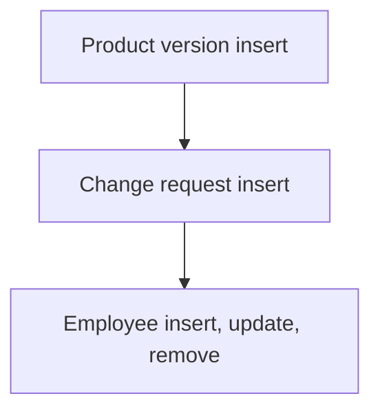

# Product Lifecycle Management

App baseline: what the Neome App gives out of the box, learnt from NA-product-lifecycle-management.

## Gives

- Product master with images, HSN, GST and stock status.
- Product versions with reason and attachments; product shows latest version.
- Change requests on a product with impact analysis and status.
- Employee master that adds, updates and removes app users with roles and manager.
- Add and list menu actions per sheet.
- Three roles with insert, update, remove rights by sheet.

## Sheets, key fields, roles

- Product: ProductName*, ProductCode, HSNCode, GSTPercentage, LatestVersion, StockStatus {pickText}, images
- ProductVersion: Product, VersionNumber*, ChangeReason, Attachments
- ChangeRequest: RefProduct →Product, RequestDate*, Status {pickText}, Reason, ImpactAnalysis*, Attachments
- Employee: EmployeeName*, Roles*, Manager, Status {pickText}, Handle*
- Roles: ProductManager, OperationManager, OrganizationAdmin.

## Workflows

- Product version insert: product row gets the latest version.
- Change request insert: product row updated; status and impact analysis kept.
- Employee insert, update, remove: app user kept in step with the row.

## Flowchart

## Execute

Only use this to apply this into a Studio Enterprise via MCP.

Only if Neome App product-lifecycle-management is not installed (check `list` first): rebuild what Gives lists. If installed, reuse it and build only gaps. Placeholders: Product, ProductVersion, ChangeRequest, Employee, roles ProductManager, OperationManager, OrganizationAdmin. Needs first: none.

1. Roles + vars: `add kind=role` x3; `add kind=var kind=setOfText` StockStatus, RequestStatus.
2. Product: `add kind=form` → `kind=composite type=section` → `type=text` ProductName, ProductCode, HSNCode, `type=decimal` GSTPercentage, `type=pickText` StockStatus, `type=text` LatestVersion (`disabled=true`), `type=image` Images → `add kind=spreadsheet name=ProductSheet` (insert / update / remove roles per sheet) → table + list layouts.
3. ProductVersion: `type=ref` Product (`spreadsheet=ProductSheet layoutSpreadsheet=<list>`), `type=text` VersionNumber, `type=paragraph` ChangeReason (verify: describe), `type=document` Attachments → `ProductVersionSheet` → table layout.
4. ChangeRequest: `type=ref` RefProduct, `type=date` RequestDate, `type=pickText` Status, `type=paragraph` Reason, ImpactAnalysis, `type=document` Attachments → `ChangeRequestSheet` → table layout.
5. Version insert: `apply PAT-update-linked-rows Execute` (`eventSsInsertAfter spreadsheet=ProductVersionSheet` → `rowUpdate` product row: LatestVersion).
6. Change request insert: same pattern (Status + ImpactAnalysis kept on the product row).
7. Employee: form + sheet with EmployeeName, Roles, Manager, Status, Handle → `apply PAT-sheet-row-drives-app-user Execute`.
8. Menu actions: add + list action per sheet (`apply PAT-action-set-menu Execute`) → `set kind=group actionPermissionMap` (roles on every entry).
9. `validate` till ok=true. `describe` ProductSheet and one workflow to confirm.

Gaps: rowId copy through `copyFieldMap` (verify: describe); target-row binder for the product update; edgeMap entry keys unverified.
