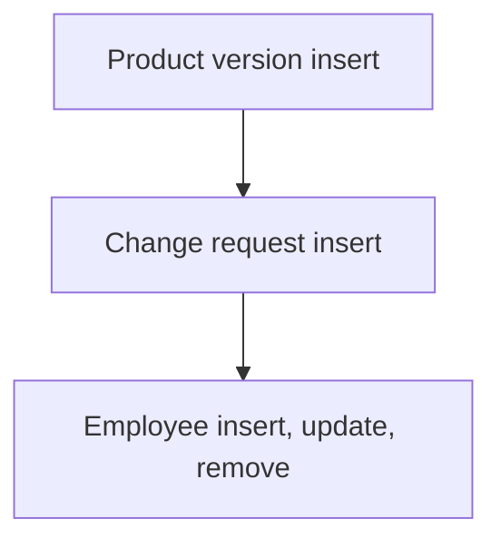

# Product Lifecycle Management

App baseline: what the Neome App gives out of the box, learnt from NA-product-lifecycle-management.

## Gives

- Product master with images, HSN, GST and stock status.
- Product versions with reason and attachments; product shows latest version.
- Change requests on a product with impact analysis and status.
- Employee master that adds, updates and removes app users with roles and manager.
- Add and list menu actions per sheet.
- Three roles with insert, update, remove rights by sheet.

## Sheets, key fields, roles

- Product: ProductName*, ProductCode, HSNCode, GSTPercentage, LatestVersion, StockStatus {pickText}, images
- ProductVersion: Product, VersionNumber*, ChangeReason, Attachments
- ChangeRequest: RefProduct →Product, RequestDate*, Status {pickText}, Reason, ImpactAnalysis*, Attachments
- Employee: EmployeeName*, Roles*, Manager, Status {pickText}, Handle*
- Roles: ProductManager, OperationManager, OrganizationAdmin.

## Workflows

- Product version insert: product row gets the latest version.
- Change request insert: product row updated; status and impact analysis kept.
- Employee insert, update, remove: app user kept in step with the row.

## Flowchart

