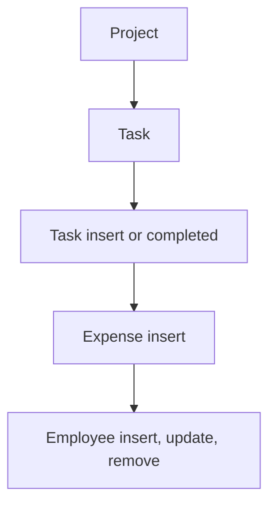

# Project Management

App baseline: what the Neome App gives out of the box, learnt from NA-project-management.

## Gives

- Admin keeps employees; adding one creates the app user, status switches it on or off.
- Admin keeps customer and expense category master lists.
- Manager adds a project with customer, team grid with billable rates, phases and budget.
- Project totals (tasks, completed, hours, expenses, cost variance) update on their own.
- Task takes project phase and team member; time taken, delay and billable cost are worked out.
- Expenses with category and documents are logged against a project.
- Project dashboard by date range and task dashboard by project.

## Sheets, key fields, roles

- Employee: Handle, Roles, Manager →user, Status {Active|Deactivate}
- Customer: CompanyName, ContactPerson, ContactNumber, Email, GSTIN
- Project: Customer →Customer, Priority {Low|Medium|High|Critical}, Status {Not Started|Active|In Progress|On Hold|...}, grids AssignEmployee and phase grid, BudgetCost, ActualCost
- Task: Project →Project, phase, TeamMember, ETC, TimeTaken, SummaryStatus {Pending|In Progress|In Review|Completed|On Hold|Cancelled}
- Expense: Project →Project, Category →ExpenseCategory, Amount, Documents
- ExpenseCategory: Category
- Roles: ProjectManager, TeamMember, OrganizationAdmin.

## Workflows

- Project: manager adds customer, team grid with rates, phases and budget; duplicate team member blocked.
- Task: picks phase and team member from the project; time taken, delay and billable cost worked out.
- Task insert or completed: project counts, hours and cost go up.
- Expense insert: project expense total goes up.
- Employee insert, update, remove: app user kept in step with the row.

## Flowchart

## Execute

Only use this to apply this into a Studio Enterprise via MCP.

Only if Neome App project-management is not installed (check `list` first): rebuild what Gives lists. If installed, reuse it and build only gaps. Placeholders: Employee, Customer, ExpenseCategory, Project, Task, Expense, roles ProjectManager, TeamMember, OrganizationAdmin. Needs first: none.

1. Roles + vars: `add kind=role` x3; `add kind=var kind=setOfText` Priority {Low|Medium|High|Critical}, ProjectStatus, SummaryStatus.
2. Masters: Customer (CompanyName, ContactPerson, ContactNumber, Email, GSTIN) → CustomerSheet; ExpenseCategory → ExpenseCategorySheet: `apply PAT-admin-kept-pick-list Execute`.
3. Project: `add kind=form` → `kind=composite type=section` → `type=ref` Customer, `type=pickText` Priority, Status, `type=decimal` BudgetCost, ActualCost (`disabled=true`); `kind=composite type=grid` Team → `type=pickUser` Member (`roleIdDataSource=[TeamMember]`) + `type=decimal` BillRate; phase grid → `ProjectSheet` → table + list layouts. Duplicate team member blocked: `apply PAT-error-field-check Execute`.
4. Task: `type=ref` Project (`copyFieldMap` copies rowId + customer), phase `type=pickText` from the project's phases (source copied — verify: describe), `type=pickUser` TeamMember, `type=number` ETC, TimeTaken, `type=decimal` BillableCost, `type=pickText` SummaryStatus → `TaskSheet` → table layout. Time taken, delay, billable cost: `apply PAT-calculated-field Execute`.
5. Expense: `type=ref` Project, `type=ref` Category (`spreadsheet=ExpenseCategorySheet`), `type=decimal` Amount, `type=document` Documents → `ExpenseSheet` → table layout.
6. Project totals: `apply PAT-update-linked-rows Execute` — task insert / SummaryStatus Completed, expense insert → `rowUpdate ProjectSheet` (task count, hours, ActualCost).
7. Employee: form + sheet with Handle, Roles, Manager, Status → `apply PAT-sheet-row-drives-app-user Execute`.
8. Dashboards: `apply PAT-query-report-with-filter Execute` (project by dateRange; tasks by Project) + `apply PAT-composite-report Execute`.
9. Actions + group: per-sheet actions + `kind=report` → `set kind=group actionPermissionMap` (roles on every entry).
10. `validate` till ok=true.

Gaps: phase source on Task (verify: describe); formula and mapping shapes across forms; edgeMap entry keys unverified.
