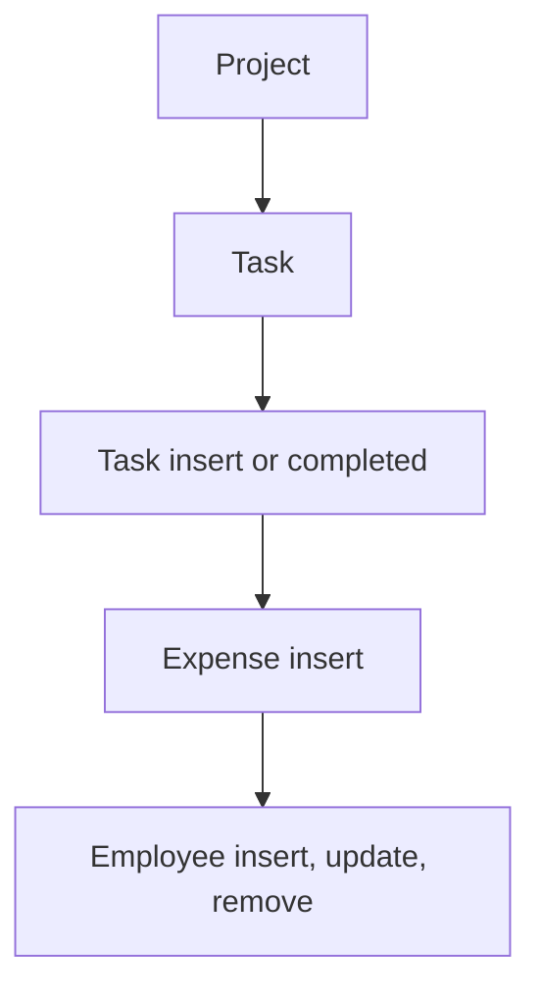

# Project Management

App baseline: what the Neome App gives out of the box, learnt from NA-project-management.

## Gives

- Admin keeps employees; adding one creates the app user, status switches it on or off.
- Admin keeps customer and expense category master lists.
- Manager adds a project with customer, team grid with billable rates, phases and budget.
- Project totals (tasks, completed, hours, expenses, cost variance) update on their own.
- Task takes project phase and team member; time taken, delay and billable cost are worked out.
- Expenses with category and documents are logged against a project.
- Project dashboard by date range and task dashboard by project.

## Sheets, key fields, roles

- Employee: Handle, Roles, Manager →user, Status {Active|Deactivate}
- Customer: CompanyName, ContactPerson, ContactNumber, Email, GSTIN
- Project: Customer →Customer, Priority {Low|Medium|High|Critical}, Status {Not Started|Active|In Progress|On Hold|...}, grids AssignEmployee and phase grid, BudgetCost, ActualCost
- Task: Project →Project, phase, TeamMember, ETC, TimeTaken, SummaryStatus {Pending|In Progress|In Review|Completed|On Hold|Cancelled}
- Expense: Project →Project, Category →ExpenseCategory, Amount, Documents
- ExpenseCategory: Category
- Roles: ProjectManager, TeamMember, OrganizationAdmin.

## Workflows

- Project: manager adds customer, team grid with rates, phases and budget; duplicate team member blocked.
- Task: picks phase and team member from the project; time taken, delay and billable cost worked out.
- Task insert or completed: project counts, hours and cost go up.
- Expense insert: project expense total goes up.
- Employee insert, update, remove: app user kept in step with the row.

## Flowchart

