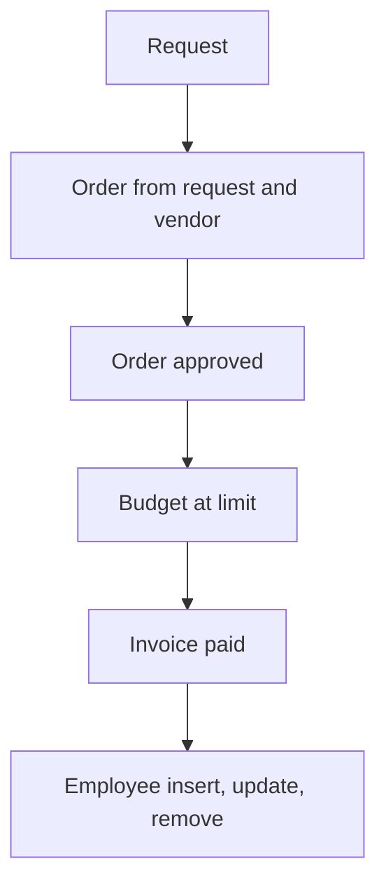

# Purchase Management

App baseline: what the Neome App gives out of the box, learnt from NA-purchase-management.

## Gives

- Admin keeps department budgets, vendors and employees.
- Staff raise purchase requests with item lines; manager approves or rejects.
- Purchase order raised from a request and a vendor; budget check error shown.
- Order approval makes a PDF and reduces the department budget.
- Invoice against an order; paid invoice makes a PDF and updates received amount.
- Employee row creates, updates and removes the app user.
- Low-budget alert; monthly budget reset.
- Dashboard of budget, order count and pending approvals by date range.

## Sheets, key fields, roles

- Department: DepartmentID, Department*, MonthlyBudget*, MinimumBudgetLimit*, RemainingMonthlyBudget (log)
- Vendor: VendorID, VendorName*, GSTIN*, MobileNumber*, PaymentTerms, Status
- Employee: EmployeeName*, Employee @user, Manager @user, Roles, Status
- PurchaseRequest: RequestDate*, RefDepartment →Department, FinalAmount, Status {Pending|Approved|Rejected}, POGiven {Yes|No}; grid Purchase: Name*, Quantity*, ExpectedPrice*, Amount
- PurchaseOrder: RefPurchaseRequest →PurchaseRequest, RefVendor →Vendor, FinalAmount, ReceivedAmount, PendingAmount, Status {Pending|Approved|Rejected}, Error; grid Purchase
- Invoice: RefPurchaseOrder →PurchaseOrder, Amount*, PaymentStatus {Pending|Paid|Unpaid}, TransactionType {UPI|Cash|Cheque|Bank Transfer}, TransactionID
- Roles: PurchaseExecutive, OperationsManager, OrganizationAdmin.

## Workflows

- Request: item lines and total; manager approves or rejects; creator told.
- Order from request and vendor: budget check error; request marked as ordered.
- Order approved: PDF made; department budget goes down; creator told.
- Budget at limit: group alert. Monthly schedule resets every department budget.
- Invoice paid: invoice PDF made; order received amount goes up.
- Employee insert, update, remove: app user kept in step with the row.

## Flowchart

## Execute

Only use this to apply this into a Studio Enterprise via MCP.

Only if Neome App purchase-management is not installed (check `list` first): rebuild what Gives lists. If installed, reuse it and build only gaps. Placeholders: Department, Vendor, Employee, PurchaseRequest, PurchaseOrder, Invoice, roles PurchaseExecutive, OperationsManager, OrganizationAdmin. Needs first: none.

1. Roles + vars: `add kind=role` x3; `add kind=var kind=setOfText` Status {Pending|Approved|Rejected}, PaymentStatus {Pending|Paid|Unpaid}, TransactionType, POGiven {Yes|No}.
2. Department: `add kind=form` → section → `type=text` DepartmentID, Department, `type=decimal` MonthlyBudget, MinimumBudgetLimit, `type=logDecimal` RemainingMonthlyBudget → `DepartmentSheet` → table + list layouts. Low-budget alert: `apply PAT-low-stock-alert Execute` (RemainingMonthlyBudget < MinimumBudgetLimit → group message).
3. Vendor: `type=text` VendorName, GSTIN, `type=mobileNumber`, PaymentTerms, Status → `VendorSheet` → table layout. Employee: `apply PAT-sheet-row-drives-app-user Execute`.
4. PurchaseRequest: `type=ref` Department, `type=date` RequestDate, `type=decimal` FinalAmount (`disabled=true`), `type=pickText` Status, POGiven; `kind=composite type=grid` Purchase → `type=text` Name, `type=number` Quantity, `type=decimal` ExpectedPrice, Amount (`apply PAT-line-items-grid-with-totals Execute`) → `PurchaseRequestSheet` → table layout. Approve / reject + tell creator: `apply PAT-approval-by-status Execute`.
5. PurchaseOrder: `type=ref` RefPurchaseRequest, `type=ref` RefVendor, `type=decimal` FinalAmount, ReceivedAmount, PendingAmount, `type=pickText` Status, `type=text` Error (`disabled=true`), same grid → `PurchaseOrderSheet` → table layout. Budget check on insert: `apply PAT-stop-save-by-workflow-check Execute` (budget short → `stopAndError`); pass → request POGiven (`apply PAT-update-linked-rows Execute`).
6. Order approved: order PDF (`apply PAT-pdf-from-report Execute`) + budget down (`apply PAT-running-total-by-log-field Execute`, `rowUpdateFieldLogNumber operation=subtract`) + message (`apply PAT-message-on-event Execute`).
7. Invoice: `type=ref` RefPurchaseOrder, `type=decimal` Amount, `type=pickText` PaymentStatus, TransactionType, `type=text` TransactionID → `InvoiceSheet` → table layout. Paid: invoice PDF + `rowUpdate` order ReceivedAmount.
8. Monthly reset: `apply PAT-scheduled-job-over-rows Execute` (`eventSchedule` months → `rowUpdate` every Department budget).
9. Dashboard: `apply PAT-query-report-with-filter Execute` (budget, order count, pending approvals; dateRange input) + `apply PAT-composite-report Execute`; actions → `set kind=group actionPermissionMap`.
10. `validate` till ok=true.

Gaps: log field write from another sheet's workflow (verify: describe); grid total → FinalAmount mapping; edgeMap entry keys unverified.
