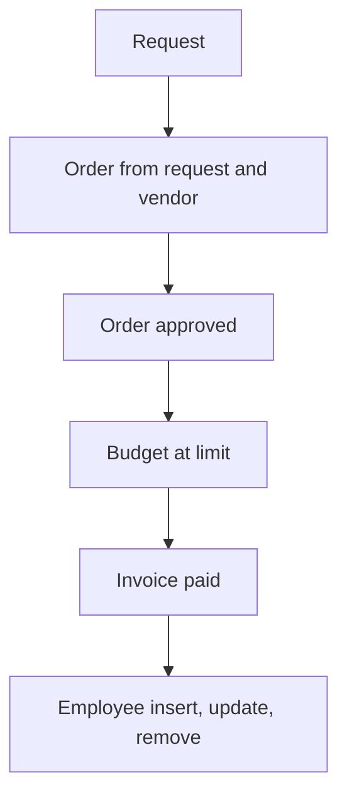

# Purchase Management

App baseline: what the Neome App gives out of the box, learnt from NA-purchase-management.

## Gives

- Admin keeps department budgets, vendors and employees.
- Staff raise purchase requests with item lines; manager approves or rejects.
- Purchase order raised from a request and a vendor; budget check error shown.
- Order approval makes a PDF and reduces the department budget.
- Invoice against an order; paid invoice makes a PDF and updates received amount.
- Employee row creates, updates and removes the app user.
- Low-budget alert; monthly budget reset.
- Dashboard of budget, order count and pending approvals by date range.

## Sheets, key fields, roles

- Department: DepartmentID, Department*, MonthlyBudget*, MinimumBudgetLimit*, RemainingMonthlyBudget (log)
- Vendor: VendorID, VendorName*, GSTIN*, MobileNumber*, PaymentTerms, Status
- Employee: EmployeeName*, Employee @user, Manager @user, Roles, Status
- PurchaseRequest: RequestDate*, RefDepartment →Department, FinalAmount, Status {Pending|Approved|Rejected}, POGiven {Yes|No}; grid Purchase: Name*, Quantity*, ExpectedPrice*, Amount
- PurchaseOrder: RefPurchaseRequest →PurchaseRequest, RefVendor →Vendor, FinalAmount, ReceivedAmount, PendingAmount, Status {Pending|Approved|Rejected}, Error; grid Purchase
- Invoice: RefPurchaseOrder →PurchaseOrder, Amount*, PaymentStatus {Pending|Paid|Unpaid}, TransactionType {UPI|Cash|Cheque|Bank Transfer}, TransactionID
- Roles: PurchaseExecutive, OperationsManager, OrganizationAdmin.

## Workflows

- Request: item lines and total; manager approves or rejects; creator told.
- Order from request and vendor: budget check error; request marked as ordered.
- Order approved: PDF made; department budget goes down; creator told.
- Budget at limit: group alert. Monthly schedule resets every department budget.
- Invoice paid: invoice PDF made; order received amount goes up.
- Employee insert, update, remove: app user kept in step with the row.

## Flowchart

