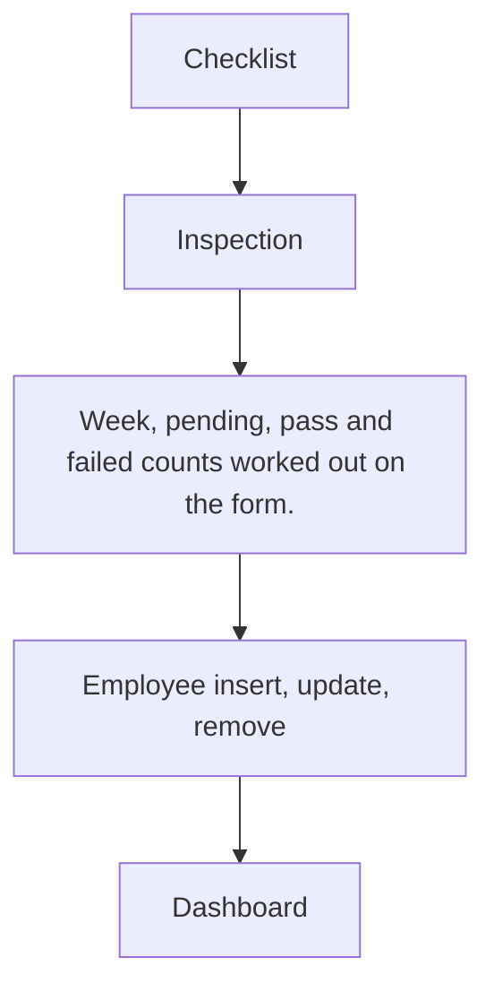

# Quality Control

App baseline: what the Neome App gives out of the box, learnt from NA-quality-control.

## Gives

- Admin builds QC checklists with parameters and tolerance.
- Inspector records GRN or Production inspections with Pass or Fail per parameter.
- Week, pending, pass and failed counts fill in by themselves.
- Dashboard with totals, rejection rate, type, status, inspector and weekly views by date range.
- Employee sheet creates and manages app users and their status.

## Sheets, key fields, roles

- QCChecklist: ChecklistId, Name*, Description, grid Checklist {ParameterName*, ToleranceRange*}
- QCInspection: Date, Week, InspectionBy @QualityInspector, InspectionType {GRN|Production}*, RefChecklist →QCChecklist, ChecklistStatus {Pass|Fail}*, Pending, Pass, Failed, Remarks, Attachments, grid Checklist {ParameterName, ToleranceRange, Result, Remarks}
- Employee: EmployeeName*, Employee pickUser, MobileNumber*, Handle*, Email, Roles, Status*, Manager
- Roles: OrganizationAdmin, QualityInspector.

## Workflows

- Checklist: admin adds parameter grid with tolerance.
- Inspection: inspector picks checklist, loads its parameters, marks Pass or Fail each.
- Week, pending, pass and failed counts worked out on the form.
- Employee insert, update, remove: app user kept in step with the row.
- Dashboard: totals, type, status, inspector and weekly view by date range.

## Flowchart

