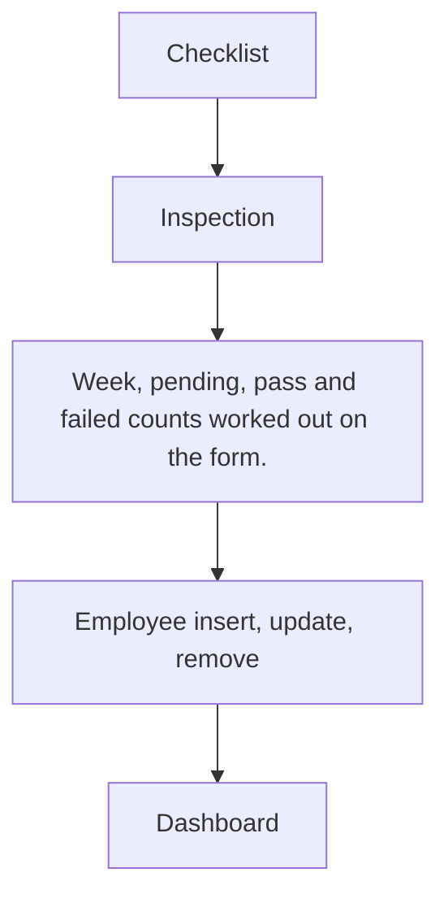

# Quality Control

App baseline: what the Neome App gives out of the box, learnt from NA-quality-control.

## Gives

- Admin builds QC checklists with parameters and tolerance.
- Inspector records GRN or Production inspections with Pass or Fail per parameter.
- Week, pending, pass and failed counts fill in by themselves.
- Dashboard with totals, rejection rate, type, status, inspector and weekly views by date range.
- Employee sheet creates and manages app users and their status.

## Sheets, key fields, roles

- QCChecklist: ChecklistId, Name*, Description, grid Checklist {ParameterName*, ToleranceRange*}
- QCInspection: Date, Week, InspectionBy @QualityInspector, InspectionType {GRN|Production}*, RefChecklist →QCChecklist, ChecklistStatus {Pass|Fail}*, Pending, Pass, Failed, Remarks, Attachments, grid Checklist {ParameterName, ToleranceRange, Result, Remarks}
- Employee: EmployeeName*, Employee pickUser, MobileNumber*, Handle*, Email, Roles, Status*, Manager
- Roles: OrganizationAdmin, QualityInspector.

## Workflows

- Checklist: admin adds parameter grid with tolerance.
- Inspection: inspector picks checklist, loads its parameters, marks Pass or Fail each.
- Week, pending, pass and failed counts worked out on the form.
- Employee insert, update, remove: app user kept in step with the row.
- Dashboard: totals, type, status, inspector and weekly view by date range.

## Flowchart

## Execute

Only use this to apply this into a Studio Enterprise via MCP.

Only if Neome App quality-control is not installed (check `list` first): rebuild what Gives lists. If installed, reuse it and build only gaps. Placeholders: QCChecklist, QCInspection, Employee, roles QualityInspector, OrganizationAdmin. Needs first: none.

1. Roles: `add kind=role` x2.
2. QCChecklist: `add kind=form` → `kind=composite type=section` → `type=text` ChecklistId, Name, Description; `kind=composite type=grid` Checklist → `type=text` ParameterName, ToleranceRange → `QCChecklistSheet` → table + list layouts.
3. QCInspection: section → `type=date` Date, `type=pickUser` InspectionBy (`roleIdDataSource=[QualityInspector]`), `type=pickText` InspectionType {GRN|Production}, `type=ref` RefChecklist (`spreadsheet=QCChecklistSheet layoutSpreadsheet=<list>`), `type=pickText` ChecklistStatus {Pass|Fail}, `type=number` Pending, Pass, Failed (all `disabled=true`), `type=paragraph` Remarks, `type=document` Attachments; `kind=composite type=grid` Checklist → ParameterName, ToleranceRange, `type=pickText` Result {Pass|Fail}, Remarks → `QCInspectionSheet` → table layout.
4. Load the picked checklist's parameters into the grid: no direct MCP shape (a ref cannot fill a grid) — `type=refReport` or button + workflow (verify: describe); if unresolvable, tell the user.
5. Self-filled counts: `apply PAT-calculated-field Execute` (Week from Date, Pending / Pass / Failed from grid Results, ChecklistStatus Fail when any line fails).
6. Employee: form + sheet with EmployeeName, `type=pickUser` Employee, `type=mobileNumber`, Handle, Email, Roles, Status, Manager → `apply PAT-sheet-row-drives-app-user Execute`.
7. Dashboard: `apply PAT-query-report-with-filter Execute` (totals, rejection rate, type, status, inspector, weekly; dateRange input) + `apply PAT-composite-report Execute`.
8. Actions + group: per-sheet actions + `kind=report` → `set kind=group actionPermissionMap` (roles on every entry).
9. `validate` till ok=true.

Gaps: grid fill from the picked checklist (verify: describe); Week formula shape (verify: describe).
